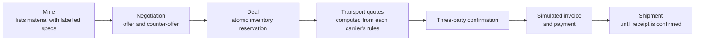

<div align="center">


# MAKNAZ | مَكْنَز

**HIDDEN RESOURCES. NEW VALUE.**

A B2B marketplace that connects **mines** holding by-products and secondary materials with **factories** that may use them and **carriers** that move them — one transaction with a clear landed cost, from listing to delivery.

[العربية](README.md) · [Documentation index (Arabic)](docs/README.md) · [Contributing](CONTRIBUTING.md) · [Security](SECURITY.md)

  

</div>

---

> [!IMPORTANT]
> **This repository is in the documentation phase.** There is no application code yet, and the stack is a proposal awaiting approval. The documents here are the source of truth for everything built later. Most documentation is written in Arabic with English technical terms.

## Problem

Some mines and quarries hold by-products that could be inputs for other industries, but access to them is unstructured: material data is inconsistent and rarely labelled by verification level, discovery is hard, **transport cost can decide whether a deal makes sense**, and the seller, buyer and carrier coordinate through scattered channels.

**One official indicator for context:** industrial-sector waste in Saudi Arabia reached **26.7 million tonnes** in 2024, of which **26.4%** came from mining and quarrying (GASTAT). This does not mean that quantity is saleable or industrially suitable — details and caveats in [OFFICIAL_STATISTICS](data/reference/OFFICIAL_STATISTICS.md).

## Solution



| What sets MAKNAZ apart | How |
|---|---|
| **Landed cost before commitment** | Material + transport + fees shown separately before confirmation |
| **Honest data** | Every spec is tagged: lab-reported · declared · estimated · unknown |
| **Carriers price themselves** | Versioned pricing rules (per km, per ton, per ton-km, fixed route); binding quotes with a frozen snapshot |
| **No payment before everyone commits** | Three-party confirmation is required before the invoice |
| **Clear deadlines** | 24h carrier window (+ one retry), 24h payment window, mine-only extensions (2 × 72h), automatic cancellation and simulated refunds |

## What MAKNAZ does not do

No AI · no automated chemical analysis · no judgement of material suitability · no regulatory permit for transporting materials · **no real money** and no tax invoices in the first version.

## Documentation

The full map of 35 topics is in the **[documentation index](docs/README.md)**; a PDF bundle is in [`docs/exports/`](docs/exports/README.md).

| Start here | Then |
|---|---|
| [Project overview](docs/00-product/PROJECT_OVERVIEW.md) | [SRS](docs/02-requirements/MAKNAZ_SRS.md) — 150 functional and 45 non-functional requirements |
| [Problem statement](docs/00-product/PROBLEM_STATEMENT.md) | [Business rules](docs/02-requirements/BUSINESS_RULES.md) |
| [Proposed solution](docs/00-product/PROPOSED_SOLUTION.md) | [Architecture](docs/03-architecture/ARCHITECTURE.md) and [database design](docs/03-architecture/DATABASE_DESIGN.md) |
| [MVP scope](docs/00-product/MVP_SCOPE.md) | [Pricing engine](docs/04-domain/LOGISTICS_PRICING_ENGINE.md) and [shipment extensions](docs/04-domain/SHIPMENT_EXTENSIONS.md) |

### Information labels

| Label | Meaning |
|---|---|
| **Verified** | From an official source with link and date |
| **Approved requirement** | A product decision approved by the team |
| **Engineering recommendation (REC)** | A technical proposal awaiting approval |
| **Hypothetical data** | Numbers for demos and simulation only |
| **Open decision (OD)** | Not yet decided — [OPEN_DECISIONS](docs/08-planning/OPEN_DECISIONS.md) |

## Team

| Member | Role |
|---|---|
| Harbi Alnasri | Team Leader |
| Mohsen Alghamdi | Software Engineer |
| Hamoud Suhail Alotaibi | Business Developer |
| Lama Alomair | Data Analyst |
| Raneem Almalki | UI/UX Designer |
| Lama Mansour | QA / Software Tester |

Responsibilities and ownership matrix: [TEAM_RESPONSIBILITIES](docs/07-team/TEAM_RESPONSIBILITIES.md).

## Repository layout

```
maknaz/
├── docs/          documentation (product, business, requirements, architecture, domain, design, quality, team, planning)
├── apps/          api/ (Express + Prisma + PostgreSQL) and web/ (React + Vite, RTL)
├── packages/      shared/ (shared types and validation) · design-tokens/ (brand colours and typography)
├── data/          reference/ (verified statistics) · templates/ (CSV templates) · demo/ (hypothetical data)
├── brand/         logo, identity board, fonts with licences
├── tools/         PDF and film generators, documentation validator
├── tests/         end-to-end tests (Playwright) and test plan
└── .github/       issue and PR templates, labels, docs validation workflow
```

## Stack

> Decision ADR-015 (closes OD-18) — see the [decision log](docs/03-architecture/TECHNICAL_DECISIONS.md).

Modular monolith · Node.js 22 + Express 5 + Zod · Prisma 7 + PostgreSQL 16 · React 19 + Vite + Tailwind CSS 4 (RTL) · Leaflet · Vitest + Playwright · database-backed deadline scheduler. Implementation status: [IMPLEMENTATION_STATUS](docs/IMPLEMENTATION_STATUS.md).

## Getting started

```bash
npm install                                 # Node.js 22.12+
cp apps/api/.env.example apps/api/.env      # then edit local values
npm run db:start                            # local PostgreSQL 16 (or any PostgreSQL 16 via DATABASE_URL)
npm run db:migrate && npm run db:seed       # in another terminal: schema, reference data, admin, labelled demo data
npm run dev                                 # API on :4000, web on http://localhost:5180
npm test                                    # unit + integration tests
npm run test:e2e                            # end-to-end tests (app must be running)
python3 tools/scripts/validate_docs.py      # docs checks, Python 3.10+ only
python3 tools/docs-pdf/build_docs.py        # rebuild the engineering PDF
```

Tool requirements: [tools/README.md](tools/README.md).

## Contributing

Read [CONTRIBUTING](CONTRIBUTING.md), the [GitHub workflow](docs/07-team/GITHUB_WORKFLOW.md) and the [Definition of Done](docs/07-team/DEFINITION_OF_DONE.md). Participation requires following the [Code of Conduct](CODE_OF_CONDUCT.md).

## License

**All rights reserved by the MAKNAZ team.** By Team Leader decision the project has no open-source licence and the repository is private; no copying or reuse without permission. Fonts in `brand/fonts/` are under the SIL Open Font License 1.1.
