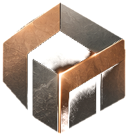
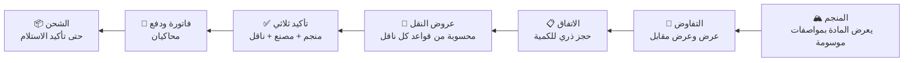

<div align="center">



# مَكْنَز | MAKNAZ

**HIDDEN RESOURCES. NEW VALUE.**

من الموارد غير المستغلة، إلى فرص صناعية قابلة للتقييم.

سوق رقمي B2B يربط **المناجم** التي تملك مخلفات ومواد ثانوية بـ**المصانع** التي قد تحتاجها، و**شركات النقل** التي تنقلها — في صفقة واحدة واضحة التكلفة من العرض حتى التسليم.

[English](README.en.md) · [فهرس الوثائق](docs/README.md) · [المساهمة](CONTRIBUTING.md) · [الأمن](SECURITY.md)

  

</div>

---

> [!IMPORTANT]
> **هذا المستودع في مرحلة التوثيق.** لا يوجد كود تطبيق بعد، والتقنيات مقترحة بانتظار الاعتماد. الوثائق هنا هي المرجع الذي يُبنى عليه كل شيء لاحقًا.

## المشكلة

قد تملك مناجم ومحاجر مخلفات ومواد ثانوية يمكن أن تكون مدخلات لمصانع أخرى، لكن الوصول إليها غير منظم:

| التحدي | الأثر |
|---|---|
| بيانات المادة متفاوتة وغير موسومة | المشتري لا يعرف ما هو موثق وما هو تقديري |
| الاكتشاف صعب | لا مكان واحد يعرض المتاح |
| **تكلفة النقل قد تحسم الجدوى** | سعر المادة وحده مضلل؛ المهم تكلفة وصولها |
| التنسيق متفرق | البائع والمشتري والناقل في قنوات منفصلة |

**مؤشر رسمي واحد للسياق:** بلغت نفايات القطاع الصناعي في المملكة **26.7 مليون طن** عام 2024، يعود **26.4%** منها إلى نشاط التعدين واستغلال المحاجر (الهيئة العامة للإحصاء). هذا لا يعني أن هذه الكمية قابلة للبيع أو ملائمة صناعيًا — التفاصيل والقيود في [OFFICIAL_STATISTICS](data/reference/OFFICIAL_STATISTICS.md).

## الحل



| ما يميّز مَكْنَز | كيف |
|---|---|
| **تكلفة الوصول قبل الالتزام** | المادة + النقل + الرسوم منفصلة وواضحة قبل التأكيد |
| **صدق البيانات** | كل مواصفة موسومة: مدعومة بتقرير · مصرّح بها · تقديرية · غير معروفة |
| **الناقل يسعّر بنفسه** | قواعد تسعير بإصدارات (كم، طن، طن·كم، مسار ثابت) وعرض ملزم بلقطة ثابتة |
| **لا دفع قبل التزام الجميع** | التأكيد الثلاثي شرط للفاتورة |
| **مهل صارمة وواضحة** | 24 ساعة للناقل (+ إعادة محاولة)، 24 ساعة للدفع، تمديد يملكه المنجم وحده (2 × 72 ساعة)، إلغاء تلقائي واسترجاع محاكٍ |

## ما لا يفعله مَكْنَز

لا ذكاء اصطناعي · لا تحليل كيميائي آلي · لا حكم بصلاحية المواد · لا إذن نظامي بنقل المواد · **لا أموال حقيقية** ولا فواتير ضريبية في النسخة الأولى.

## الوثائق

| ابدأ هنا | ثم |
|---|---|
| [نظرة عامة](docs/00-product/PROJECT_OVERVIEW.md) | [مواصفة المتطلبات (SRS)](docs/02-requirements/MAKNAZ_SRS.md) — 150 متطلبًا وظيفيًا و45 غير وظيفي |
| [المشكلة](docs/00-product/PROBLEM_STATEMENT.md) | [قواعد العمل](docs/02-requirements/BUSINESS_RULES.md) |
| [الحل المقترح](docs/00-product/PROPOSED_SOLUTION.md) | [المعمارية](docs/03-architecture/ARCHITECTURE.md) و[قاعدة البيانات](docs/03-architecture/DATABASE_DESIGN.md) |
| [نطاق النسخة الأولى](docs/00-product/MVP_SCOPE.md) | [محرك التسعير](docs/04-domain/LOGISTICS_PRICING_ENGINE.md) و[تمديد الشحن](docs/04-domain/SHIPMENT_EXTENSIONS.md) |

الخريطة الكاملة للموضوعات الخمسة والثلاثين في **[فهرس الوثائق](docs/README.md)**، ونسخة PDF في [`docs/exports/`](docs/exports/README.md).

### كيف نميّز المعلومة

| الوسم | المعنى |
|---|---|
| **موثّق** | من مصدر رسمي برابط وتاريخ |
| **متطلب معتمد** | قرار منتج اعتمده الفريق |
| **توصية هندسية (REC)** | اقتراح تقني بانتظار الاعتماد |
| **بيانات افتراضية** | أرقام للعرض والمحاكاة فقط |
| **قرار مفتوح (OD)** | لم يُحسم — [OPEN_DECISIONS](docs/08-planning/OPEN_DECISIONS.md) |

## الفريق

| العضو | الدور |
|---|---|
| حربي الناصري | قائد الفريق (Team Leader) |
| محسن الغامدي | مهندس برمجيات (Software Engineer) |
| حمود سهيل العتيبي | تطوير الأعمال (Business Developer) |
| لمى العمير | تحليل البيانات (Data Analyst) |
| رنيم المالكي | تصميم الواجهة والتجربة (UI/UX Designer) |
| لمى منصور | ضمان الجودة والاختبار (QA / Software Tester) |

المسؤوليات التفصيلية ومصفوفة الملكية في [TEAM_RESPONSIBILITIES](docs/07-team/TEAM_RESPONSIBILITIES.md).

## هيكل المستودع

```
maknaz/
├── docs/          الوثائق (المنتج، الأعمال، المتطلبات، المعمارية، النطاق، التصميم، الجودة، الفريق، التخطيط)
├── apps/          api/ و web/ — حدود التطبيقات المخططة (لا كود بعد)
├── packages/      design-tokens/ — ألوان الهوية والخطوط
├── data/          reference/ (إحصاءات موثقة) · templates/ (قوالب CSV) · demo/ (بيانات افتراضية)
├── brand/         الشعار، لوحة الهوية، الخطوط بتراخيصها
├── tools/         مولدات PDF والفيلم، وسكربت فحص الوثائق
├── tests/         خطة هيكل الاختبارات
└── .github/       قوالب Issues وPR، الوسوم، فحص الوثائق
```

## التقنيات المقترحة

> توصية هندسية بانتظار القرار OD-18 — [سجل القرارات](docs/03-architecture/TECHNICAL_DECISIONS.md).

Modular Monolith · Django 5 + DRF · PostgreSQL 16 · Next.js + TypeScript + Tailwind (RTL) · معالج مهل قائم على قاعدة البيانات.

## البدء

```bash
# فحص الوثائق (Python 3.10+ فقط)
python3 tools/scripts/validate_docs.py

# توليد PDF الوثائق الهندسية
python3 tools/docs-pdf/build_docs.py
```

متطلبات الأدوات في [tools/README.md](tools/README.md).

## المساهمة

اقرأ [CONTRIBUTING](CONTRIBUTING.md) ثم [سير العمل على GitHub](docs/07-team/GITHUB_WORKFLOW.md) و[تعريف الإنجاز](docs/07-team/DEFINITION_OF_DONE.md). الالتزام بـ[ميثاق السلوك](CODE_OF_CONDUCT.md) شرط للمشاركة.

## الترخيص

**كل الحقوق محفوظة لفريق مَكْنَز.** المشروع دون ترخيص مفتوح، والمستودع خاص (Private)، بقرار قائد الفريق؛ لا يحق نسخ الكود أو الوثائق أو استخدامها دون إذن. الخطوط في `brand/fonts/` بترخيص SIL Open Font License 1.1.

---

<div align="center">
<sub>مَكْنَز — مشروع مشارك في هاكاثون النقل «نقلثون»</sub>
</div>
