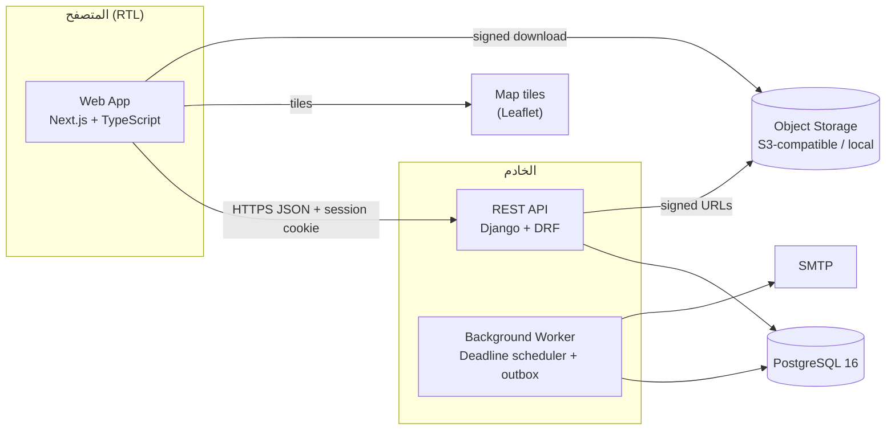
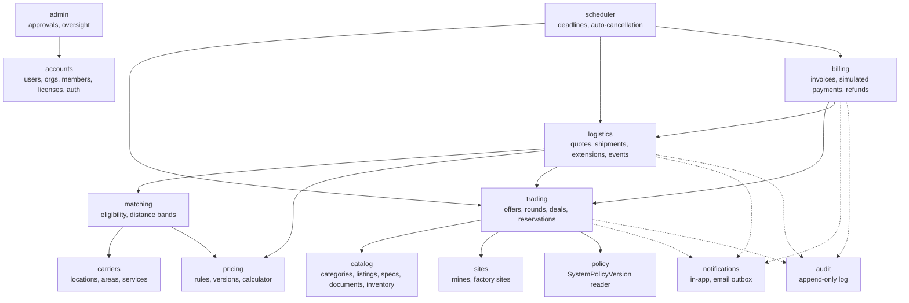
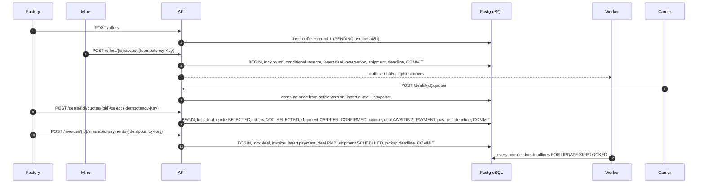
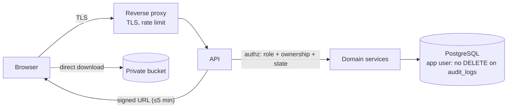

# المعمارية — مَكْنَز | MAKNAZ

[← فهرس الوثائق](../README.md) · [SRS](../02-requirements/MAKNAZ_SRS.md)

## 1. القرار المعماري

**Modular Monolith** — تطبيق خلفي واحد بوحدات نطاق ذات حدود صريحة، قاعدة بيانات PostgreSQL واحدة، وواجهة ويب منفصلة. (REC)

| البديل | لماذا لم يُختر |
|---|---|
| Microservices | فريق صغير ومدة 8 أيام؛ المعاملات الحرجة (الحجز، التأكيد الثلاثي، الدفع) تحتاج ذرية في قاعدة واحدة؛ كلفة تشغيل وشبكات بلا عائد الآن |
| Serverless functions | المهام المجدولة والمعاملات متعددة الجداول أصعب؛ صعوبة الاختبار المحلي |
| Full-stack framework واحد للواجهة والخلفية | ممكن، لكن فصل الـAPI يسهل الاختبار المستقل وتطبيق التفويض في طبقة واحدة |

## 2. نظرة عامة



## 3. الوحدات وحدودها



| الوحدة | المسؤولية | يملك الجداول | ممنوع |
|---|---|---|---|
| accounts | المصادقة، الجهات، العضوية، التراخيص المصرّحة | users, organizations, organization_members, organization_licenses | — |
| sites | المناجم ومواقع المصانع | mines, factory_sites | — |
| catalog | العروض والمواصفات والوثائق وكميات المخزون | material_* , inventory_reservations (قراءة) | تعديل الحجز مباشرة (عبر trading فقط) |
| trading | العروض والجولات والصفقات والحجز | purchase_offers, offer_negotiation_rounds, deals, inventory_reservations | الوصول لجداول الدفع |
| carriers | ملف الناقل ومواقعه ومناطقه وخدماته | carrier_* (عدا التسعير) | — |
| pricing | القواعد والإصدارات وحاسبة السعر النقية | carrier_pricing_rules, carrier_pricing_rule_versions | أي أثر جانبي في الحاسبة |
| matching | الأهلية والمسافات والنطاقات | (قراءة فقط) | الكتابة |
| logistics | عروض النقل، الشحنات، التمديد، إعادة التأكيد | transport_quotes, shipments, shipment_* | تعديل أسعار الصفقة |
| billing | الفاتورة والدفع والاسترجاع المحاكاة | invoices, invoice_items, simulated_payments, simulated_refunds | أي تكامل مالي خارجي |
| scheduler | تسجيل المهل وتنفيذها | scheduled_deadlines | منطق عمل خاص؛ يستدعي خدمات الوحدات |
| notifications | الإشعارات والبريد | notifications | — |
| audit | سجل التدقيق | audit_logs | UPDATE/DELETE |
| policy | قراءة الإصدار الساري | system_policy_versions | الكتابة من الواجهة (Post-MVP) |
| admin | الاعتماد والإشراف | — (يستدعي خدمات) | تجاوز آلات الحالة |

**قاعدة الحدود:** الوحدات تتواصل عبر دوال خدمة عامة (`trading.services.accept_offer(...)`) لا عبر نماذج ORM لوحدة أخرى، عدا القراءة. هذه القاعدة تسمح بفصل وحدة لاحقًا (NFR-015).

### طبقات كل وحدة

`api` (serializers + views: تحقق المدخلات والتفويض) ← `services` (منطق العمل والانتقالات والمعاملات) ← `models/repositories` (البيانات) + `domain` (دوال نقية: آلات الحالة، الحاسبة).

## 4. تدفق البيانات — من الاتفاق إلى الدفع



## 5. مواصفات محرك التسعير

### 5.1 المفاهيم

| المفهوم | التعريف | التخزين |
|---|---|---|
| **PricingRule** | قاعدة تسعير لخدمة ناقل محددة | `carrier_pricing_rules` |
| **PricingRuleVersion** | معاملات القاعدة في فترة صلاحية؛ غير قابل للتعديل بعد `ACTIVE` | `carrier_pricing_rule_versions` |
| **TransportQuote** | عرض ملزم لصفقة محسوب من إصدار محدد | `transport_quotes` |
| **QuoteStatus** | `SUBMITTED`, `SELECTED`, `NOT_SELECTED`, `WITHDRAWN`, `EXPIRED`, `RELEASED`, `FULFILLED` | عمود `status` |
| **QuoteExpiration** | `expires_at` = المهلة الحالية للصفقة؛ تُمدد عند بدء فترة إعادة المحاولة | عمود `expires_at` |
| **PricingSnapshot** | JSON ثابت بكل المدخلات والمعاملات والبنود والتقريب | `transport_quotes.pricing_snapshot` |
| **ShipmentPrice** | `transport_total_halalas` للعرض المختار، المنسوخ إلى الفاتورة | `invoices.transport_total_halalas` |
| **AdditionalFees** | تحميل، تفريغ، مناولة (داخلة في الإجمالي)؛ انتظار (مشروط، خارج الإجمالي) | بنود في اللقطة و`invoice_items` |

### 5.2 المدخلات

| المدخل | المصدر |
|---|---|
| `W` الوزن بالطن | كمية الصفقة |
| `D` مسافة المسار بالكم | `route_distance_km` يؤكدها الناقل (OD-10) |
| `T` عدد الرحلات | ⌈W ÷ `payload_tons_per_vehicle`⌉ |
| المعاملات | الإصدار الساري `ACTIVE` و`valid_from ≤ now < valid_to` |

### 5.3 الصيغ (نموذج واحد لكل إصدار)

| النموذج | الأساس |
|---|---|
| `PER_KM` | `D × rate_per_km × (T إن كان distance_basis = PER_TRIP وإلا 1)` |
| `PER_TON` | `W × rate_per_ton` |
| `PER_TON_KM` | `W × D × rate_per_ton_km` |
| `FIXED_ROUTE` | `fixed_route_price` (يتطلب تطابق منطقة المنشأ والوجهة) |

ثم:

```
fee(x)      = x_fee            if fee_basis = FLAT
            = x_fee × W        if fee_basis = PER_TON
subtotal    = base_fee + BASE + fee(loading) + fee(unloading) + fee(handling)
total       = max(subtotal, minimum_charge)
adjustment  = total − subtotal   (سطر MINIMUM_CHARGE_ADJUSTMENT إن > 0)
waiting     = conditional only; NOT added to total (OD-20)
```

**ممنوع** جمع نماذج مختلفة (مثلًا PER_KM + PER_TON) ما لم يُعرّف نموذج مركب صريح (FUTURE).

### 5.4 الحساب والتقريب

- الحساب بـ `Decimal` (لا `float`)، معدلات `numeric(14,4)`.
- كل سطر يُحسب بالريال العشري ثم يُحول إلى هللة بتقريب **ROUND_HALF_UP** على مستوى السطر؛ الإجمالي = مجموع الأسطر المقربة (لا إعادة تقريب).
- العملة `SAR` فقط؛ أي إصدار بعملة أخرى يُرفض في MVP.

### 5.5 التحقق والحالات الحدية

| الحالة | السلوك |
|---|---|
| `W < min_shipment_tons` أو `> max_shipment_tons` | `422 CAPACITY_MISMATCH` |
| `T × payload` < W (لا يحدث بالسقف) / `T > vehicles_available × 10` | تحذير في العرض: «يتطلب رحلات متعددة لكل مركبة» |
| `D < straight_line(mine, factory)` | `422 ROUTE_DISTANCE_TOO_SHORT` |
| `D > 3 × straight_line` | قبول مع علم مراجعة للإدارة |
| لا إصدار ساري | `409 NO_ACTIVE_PRICING` |
| `FIXED_ROUTE` ومنطقة لا تطابق | الخدمة غير مؤهلة |
| معدلات صفرية | مسموحة (عرض مجاني ممكن نظريًا) بشرط `total > 0` |
| تغيير الإصدار بين المعاينة والتقديم | الحساب يُعاد عند التقديم؛ العرض يحمل الإصدار المستخدم فعليًا |
| تغيير الإصدار بعد التقديم | لا أثر؛ اللقطة ثابتة |

### 5.6 مثال (مطابق للملف التعريفي)

`PER_TON_KM`, `W = 600`, `D = 180`, `rate = 0.20` ← `600 × 180 × 0.20 = 21,600.00 ر.س` = `2,160,000` هللة؛ `T = ⌈600 ÷ 34⌉ = 18`.

### 5.7 شكل اللقطة

```json
{
  "engine_version": "1.0",
  "pricing_rule_version_id": "01JC...",
  "model": "PER_TON_KM",
  "inputs": { "weight_tons": "600.000", "route_distance_km": "180.0", "trips": 18,
              "payload_tons_per_vehicle": "34.000", "straight_line_km_mine_to_factory": "142.6" },
  "params": { "rate_per_ton_km": "0.2000", "base_fee_halalas": 0, "minimum_charge_halalas": 300000,
              "fee_basis": "FLAT", "distance_basis": "PER_SHIPMENT" },
  "lines": [ { "code": "BASE", "amount_halalas": 2160000 } ],
  "conditional": [ { "code": "WAITING", "rate_halalas_per_hour": 15000, "free_hours": "2.0" } ],
  "rounding": "ROUND_HALF_UP_PER_LINE",
  "total_halalas": 2160000,
  "currency": "SAR",
  "computed_at": "2026-11-04T10:15:00Z"
}
```

## 6. المطابقة الجغرافية

1. **المرشحات (SQL):** خدمات نشطة لجهات `ACTIVE` تدعم `cargo_class`، بنمط مفعّل، بحدود وزن تشمل الكمية، بمنطقة خدمة تشمل منطقتي المنجم والمصنع، ولها إصدار ساري.
2. **المسافة:** لكل ناقل، أقرب موقع تشغيلي نشط إلى المنجم بـ Haversine (دالة SQL)، مع تصفية أولية بمربع إحداثي.
3. **النطاق:** `B1 ≤ 50 < B2 ≤ 150 < B3 ≤ 300 < B4`.
4. **النطاق المسموح:** الفترة الأولى B1–B3؛ فترة إعادة المحاولة تضيف B4 (BR-038). REC قابل للضبط.
5. **الترتيب:** النطاق ثم المسافة ثم وجود عرض مقدم.
6. **الوسوم:** كل مسافة مباشرة موسومة؛ تقدير الطريق = مباشرة × 1.3 موسوم «تقدير».

## 7. التقنيات المقترحة والمفاضلة

| الطبقة | التوصية | المبرر | المفاضلة |
|---|---|---|---|
| الخلفية | **Django 5 + Django REST Framework** | ORM يدعم القيود والفهارس الجزئية و`select_for_update`؛ لوحة إدارة جاهزة تسرّع شاشات الاعتماد؛ مصادقة ناضجة | Python؛ إن كان الفريق أقوى في TypeScript فالبديل NestJS + Prisma مع SQL يدوي للقيود (OD-18) |
| قاعدة البيانات | **PostgreSQL 16** | قيود CHECK وEXCLUDE وفهارس جزئية وjsonb و`SKIP LOCKED` | — |
| المهام الخلفية | **Procrastinate** (طابور على PostgreSQL) أو أمر إدارة بـ cron كل دقيقة | لا حاجة لـ Redis؛ المهل في قاعدة البيانات أصلًا | Celery + Redis أقوى لكن يضيف خدمة |
| الواجهة | **Next.js 14 (App Router) + TypeScript + Tailwind CSS** مع `dir="rtl"` | دعم RTL عبر الخصائص المنطقية؛ مكونات قابلة لإعادة الاستخدام | بديل أبسط: React + Vite SPA |
| مكونات الواجهة | Radix UI / shadcn مع تخصيص الهوية | وصولية جاهزة | — |
| الخرائط | Leaflet + بلاطات بشروط استخدام مقبولة | مجاني، بلا مفتاح | للإنتاج: مزود بلاطات مرخص |
| الملفات | تخزين S3-compatible (أو قرص محلي في العرض) | روابط موقعة | — |
| PDF الفاتورة | WeasyPrint أو Playwright من HTML | دعم العربية مع خط مضمن | — |
| الخط | IBM Plex Sans Arabic للواجهة والوثائق التقنية، وTajawal للهوية التسويقية | قراءة أفضل للبيانات الكثيفة | — |
| المراقبة | Sentry + سجلات JSON | — | — |
| النشر | Docker Compose على خادم واحد (API، Worker، Web، PostgreSQL) خلف Caddy/Nginx مع TLS | كافٍ للعرض التجريبي | — |

## 8. المصادقة والتفويض

- جلسة خادم (Django sessions) بملف تعريف آمن + CSRF. مناسب لتطبيق ويب من نطاق واحد.
- `request.org` يُحدد من العضوية النشطة؛ كل View يعلن `required_org_types` و`required_member_role`.
- `get_scoped_object(model, id, scope)` يعيد `404` عند غياب الملكية/الطرفية.
- خدمات الانتقال تتحقق من الحالة دائمًا، حتى إن تحقق الـView.
- الإدارة: `is_platform_admin` مع مسارات `/admin/*` فقط، وتسجيل كل إجراء.

## 9. المهام الخلفية

| المهمة | التكرار | الوصف |
|---|---|---|
| `process_due_deadlines` | كل دقيقة | يجلب ≤ 200 مهلة مستحقة `FOR UPDATE SKIP LOCKED`، ينفذ كلًا في معاملة مستقلة (UC-023) |
| `dispatch_outbox` | كل 15 ثانية | يرسل البريد للإشعارات المعلّمة |
| `reconcile_inventory` | كل ساعة | يتحقق `SUM(active reservations) = reserved_quantity`؛ ينبه عند الاختلاف |
| `cleanup_idempotency` | يوميًا | يحذف السجلات المنتهية |

متانة: المهل صفوف في قاعدة البيانات، فلا تضيع عند إعادة التشغيل؛ catch-up تلقائي.

## 10. حدود الأمان



- الحاوية خاصة؛ لا وصول عام للملفات.
- مستخدم قاعدة البيانات للتطبيق لا يملك `UPDATE/DELETE` على `audit_logs`.
- الأسرار في متغيرات البيئة؛ لا أسرار في المستودع.
- رؤوس أمان: CSP، HSTS، `X-Content-Type-Options`، `Referrer-Policy`.

## 11. معالجة الأخطاء

| الطبقة | المعالجة |
|---|---|
| التحقق | `422`/`400` بصيغة موحدة مع `field_errors` |
| تعارض الحالة | `409` مع `code` محدد؛ الواجهة تعيد تحميل المورد وتعرض الحالة الجديدة |
| جمود/تسلسل قاعدة البيانات | إعادة مرة واحدة تلقائيًا ثم `409 STATE_CONFLICT` (`retryable: true`) |
| فشل مهمة | إعادة حتى 5 مرات بتراجع أسي، ثم `FAILED` وتنبيه |
| خطأ غير متوقع | `500` مع `request_id`؛ تفاصيل في Sentry فقط |

## 12. النشر

| البيئة | الغرض |
|---|---|
| local | Docker Compose للتطوير |
| staging/demo | خادم واحد، بيانات تجريبية موسومة، نسخ احتياطي يومي |

الترحيلات تعمل تلقائيًا عند النشر؛ البذرة (الفئات، الأنماط، السياسة v1، المدير) أمر إدارة منفصل.

## 13. استراتيجية التوسع المستقبلي

| الضغط | الخطوة |
|---|---|
| حجم البحث | فهارس نصية عربية محسنة، ثم محرك بحث مخصص |
| المطابقة الجغرافية | PostGIS + فهارس مكانية؛ خدمة توجيه (OSRM) لمسافات الطريق |
| المهام | فصل Worker في عملية/خادم مستقل؛ طابور مخصص |
| وحدة ثقيلة (logistics) | فصلها خدمة عبر حدود الخدمات الحالية وأحداث outbox |
| مدفوعات حقيقية | وحدة billing تستبدل محول المحاكاة بمحول بوابة، مع إبقاء الواجهة الداخلية |
| تعديل السياسات | واجهة إدارية تكتب إصدارًا جديدًا في `system_policy_versions` دون تغيير منطق الانتقالات |
