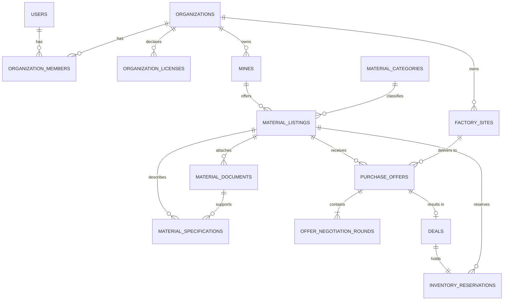
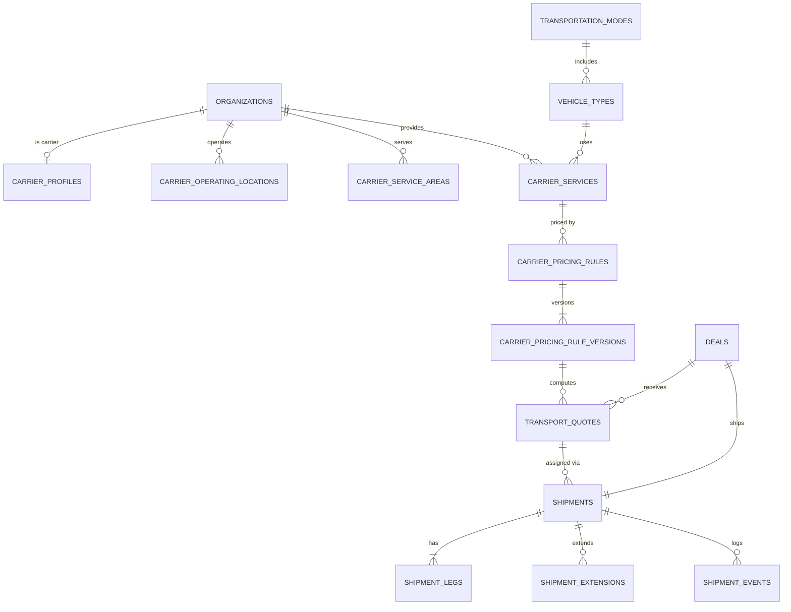
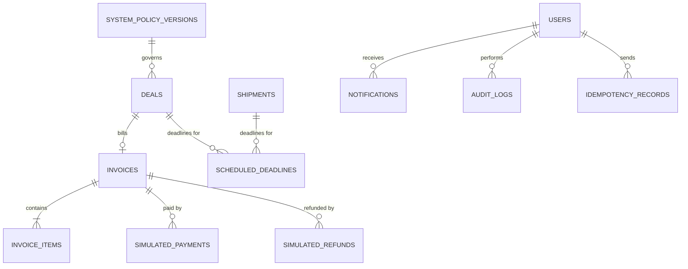

# تصميم قاعدة البيانات — مَكْنَز | MAKNAZ

[← فهرس الوثائق](../README.md) · [SRS](../02-requirements/MAKNAZ_SRS.md)

## 1. القرارات العامة

| القرار | التفصيل | تصنيف |
|---|---|---|
| المحرك | PostgreSQL 16 | REC |
| المفاتيح | `uuid` (UUIDv7 مولد في التطبيق) لكل الجداول؛ لا معرفات متسلسلة في الواجهات | REC |
| الأزمنة | `timestamptz` بتوقيت UTC؛ `created_at`, `updated_at` في كل جدول قابل للتعديل | APPROVED |
| المال | `bigint` بالهللة (`*_halalas`)؛ العملة `char(3)` افتراضيًا `'SAR'` | APPROVED |
| الأسعار والمعدلات | `numeric(14,4)` للمعدلات (ر.س لكل كم/طن/طن·كم)؛ النتيجة تُقرّب إلى هللة | APPROVED |
| الكميات | `numeric(12,3)` بالطن | ASSUMPTION |
| الإحداثيات | `numeric(9,6)` لـ lat/lng + فهرس مركب؛ Haversine في SQL. PostGIS تحسين لاحق | REC |
| الحالات | `text` + `CHECK (status IN (...))` بدل أنواع ENUM لتسهيل الترحيل | REC |
| التزامن | عمود `version int` للقفل المتفائل في الصفوف كثيرة التعديل، و`SELECT ... FOR UPDATE` للانتقالات الحرجة | APPROVED |
| الحذف | لا حذف فعلي للكيانات التجارية؛ `archived_at` أو حالة | REC |
| JSON | `jsonb` للقطات فقط، لا لبيانات قابلة للاستعلام المتكرر | REC |

### تبرير الدمج مقارنة بالقائمة المقترحة

| المقترح | القرار | السبب |
|---|---|---|
| `OrganizationRoles` | عمود `role` في `organization_members` + `CHECK` | دوران ثابتان لا يحتاجان جدولًا |
| `MineLocations` | مدمج في `mines` (كل منجم موقع) | «منجم» في النظام = موقع تعديني؛ المناجم المتعددة = صفوف متعددة |
| `MaterialInventory` | أعمدة الكميات في `material_listings` + جدول `inventory_reservations` | الحجز الذري يتطلب صفًا واحدًا للقفل؛ جدول الحجوزات للتتبع والتحرير |
| `Deals` و`PurchaseOffers` | جدولان منفصلان | العرض قد لا ينتج صفقة؛ الصفقة تحمل دورة النقل والدفع |
| `ShipmentLegs` | مُنشأ، مع ساق واحدة في MVP | دعم متعدد الأنماط مستقبلًا دون إعادة تصميم |
| جداول إضافية | `factory_sites`, `organization_licenses`, `inventory_reservations`, `scheduled_deadlines`, `idempotency_records`, `material_categories.cargo_class` | مواقع المصانع، التراخيص المصرّحة، الحجز، المهل الموثوقة، منع التكرار |

## 2. مخطط ERD

المخطط مقسم إلى ثلاثة نطاقات للقراءة؛ الكيانات المشتركة تظهر في أكثر من مخطط.

### 2.1 الجهات والمواقع والمواد والتفاوض



### 2.2 الناقلون والتسعير والشحن



### 2.3 الفوترة المحاكاة والنظام



## 3. الجداول

> الاختصارات: **PK** مفتاح أساسي · **FK** مفتاح أجنبي · **NN** غير فارغ · **UQ** فريد · **CK** قيد تحقق · **IX** فهرس

### 3.1 الهوية والجهات

#### `users`
الغرض: حسابات الدخول.

| العمود | النوع | NN | افتراضي | ملاحظات |
|---|---|---|---|---|
| id | uuid | ✅ | — | PK |
| email | citext | ✅ | — | UQ |
| password_hash | text | ✅ | — | Argon2id |
| full_name | text | ✅ | — | — |
| phone | text | — | — | — |
| email_verified_at | timestamptz | — | — | — |
| is_platform_admin | boolean | ✅ | false | إدارة المنصة |
| status | text | ✅ | `'ACTIVE'` | CK: `ACTIVE`, `DISABLED` |
| last_login_at | timestamptz | — | — | — |
| created_at / updated_at | timestamptz | ✅ | now() | — |

الوصول: المستخدم يقرأ ويعدل سجله؛ الإدارة للقراءة.

#### `organizations`

| العمود | النوع | NN | افتراضي | ملاحظات |
|---|---|---|---|---|
| id | uuid | ✅ | — | PK |
| type | text | ✅ | — | CK: `FACTORY`, `MINE`, `CARRIER`؛ ثابت |
| legal_name_ar / legal_name_en | text | ✅ / — | — | — |
| commercial_registration_no | text | ✅ | — | UQ مع `type` |
| city, region_code | text | ✅ | — | `region_code` من 13 منطقة إدارية |
| contact_email, contact_phone | text | ✅ | — | — |
| logo_object_key | text | — | — | — |
| status | text | ✅ | `'PENDING_REVIEW'` | CK: `PENDING_REVIEW`, `ACTIVE`, `REJECTED`, `SUSPENDED` |
| status_reason | text | — | — | إلزامي عند `REJECTED`/`SUSPENDED` (CK) |
| reviewed_by, reviewed_at | uuid FK users, timestamptz | — | — | — |
| created_at / updated_at | timestamptz | ✅ | now() | — |

IX: `(type, status)`. الوصول: الأعضاء والإدارة كاملًا؛ الآخرون ملف عام مختصر عند `ACTIVE`.

#### `organization_members`

| العمود | النوع | NN | ملاحظات |
|---|---|---|---|
| id | uuid | ✅ | PK |
| organization_id | uuid | ✅ | FK organizations ON DELETE RESTRICT |
| user_id | uuid | ✅ | FK users |
| role | text | ✅ | CK: `OWNER`, `MEMBER` |
| status | text | ✅ | CK: `INVITED`, `ACTIVE`, `REMOVED` |
| created_at | timestamptz | ✅ | — |

UQ: `(organization_id, user_id)`. UQ جزئي: مالك واحد على الأقل يُفرض في الخدمة. ASSUMPTION: المستخدم عضو في جهة واحدة نشطة في MVP ← UQ جزئي `(user_id) WHERE status='ACTIVE'`.

#### `organization_licenses`
تراخيص يصرّح بها المنجم أو الناقل (BR-090).

| العمود | النوع | NN | ملاحظات |
|---|---|---|---|
| id | uuid | ✅ | PK |
| organization_id | uuid | ✅ | FK |
| license_type | text | ✅ | مثل `COMMERCIAL_TRANSPORT`, `WASTE_TRANSPORT_PERMIT`, `MINING_LICENSE`, `OTHER` |
| license_number, issuing_authority | text | ✅ | — |
| expires_on | date | — | — |
| document_object_key | text | — | — |
| review_status | text | ✅ | CK: `NOT_REVIEWED`, `REVIEWED_DOCUMENT_PRESENT`, `REVIEWED_ISSUE_FOUND`؛ افتراضي `NOT_REVIEWED` |
| reviewed_by, reviewed_at | uuid, timestamptz | — | — |

### 3.2 المواقع

#### `mines`

| العمود | النوع | NN | ملاحظات |
|---|---|---|---|
| id | uuid | ✅ | PK |
| organization_id | uuid | ✅ | FK؛ جهة من نوع MINE (تُفرض في الخدمة + trigger اختياري) |
| name | text | ✅ | — |
| primary_activity | text | ✅ | النشاط التعديني الرئيسي (نص أو رمز) |
| region_code | text | ✅ | — |
| address_text | text | — | — |
| lat, lng | numeric(9,6) | ✅ | CK: `lat BETWEEN -90 AND 90`, `lng BETWEEN -180 AND 180` |
| status | text | ✅ | CK: `ACTIVE`, `INACTIVE` |
| created_at / updated_at | timestamptz | ✅ | — |

IX: `(organization_id)`, `(region_code, status)`, `(lat, lng)`.

#### `factory_sites`
مثل `mines` دون `primary_activity`، مع `organization_id` لجهة FACTORY. IX: `(organization_id)`.

#### `carrier_operating_locations`

| العمود | النوع | NN | ملاحظات |
|---|---|---|---|
| id | uuid | ✅ | PK |
| organization_id | uuid | ✅ | FK؛ جهة CARRIER |
| name | text | ✅ | مثل «ساحة أسطول ينبع» |
| location_kind | text | ✅ | CK: `FLEET_YARD`, `DEPOT`, `PORT`, `RAIL_TERMINAL`؛ ليست المقر الإداري |
| region_code, country_code | text | ✅ | `country_code` افتراضي `'SA'` |
| lat, lng | numeric(9,6) | ✅ | CK النطاق |
| is_active | boolean | ✅ | true |

IX: `(organization_id, is_active)`, `(lat, lng)`.

#### `carrier_service_areas`

| العمود | النوع | NN | ملاحظات |
|---|---|---|---|
| id | uuid | ✅ | PK |
| organization_id | uuid | ✅ | FK |
| area_type | text | ✅ | CK: `REGION`, `COUNTRY`, `RADIUS` |
| region_code | text | — | إلزامي إذا `REGION` |
| country_code | text | — | إلزامي إذا `COUNTRY` |
| operating_location_id, radius_km | uuid, numeric(7,1) | — | إلزاميان إذا `RADIUS` |

CK: اتساق الحقول مع `area_type`. IX: `(organization_id)`, `(region_code)`.

### 3.3 المواد

#### `material_categories`

| العمود | النوع | NN | ملاحظات |
|---|---|---|---|
| id | uuid | ✅ | PK |
| code | text | ✅ | UQ، مثل `SLAG`, `TAILINGS`, `WASTE_ROCK`, `QUARRY_FINES` |
| name_ar, name_en | text | ✅ | — |
| cargo_class | text | ✅ | CK: `BULK_SOLID`, `FINE_POWDER`, `SLURRY`, `PACKAGED`, `SPECIAL` |
| is_active | boolean | ✅ | true |

#### `material_listings`

| العمود | النوع | NN | افتراضي | ملاحظات |
|---|---|---|---|---|
| id | uuid | ✅ | — | PK |
| mine_id | uuid | ✅ | — | FK mines |
| organization_id | uuid | ✅ | — | FK (مكرر من المنجم لتسريع فحص الملكية) |
| category_id | uuid | ✅ | — | FK |
| title, description | text | ✅ / — | — | — |
| physical_state | text | ✅ | — | CK: `SOLID_LUMP`, `GRANULAR`, `POWDER`, `SLURRY`, `OTHER` |
| unit | text | ✅ | `'TON'` | CK: `TON` (A-02) |
| total_quantity | numeric(12,3) | ✅ | — | CK > 0 |
| reserved_quantity | numeric(12,3) | ✅ | 0 | CK ≥ 0 |
| sold_quantity | numeric(12,3) | ✅ | 0 | CK ≥ 0 |
| asking_price_halalas | bigint | ✅ | — | لكل طن؛ CK > 0 |
| currency | char(3) | ✅ | `'SAR'` | — |
| is_negotiable | boolean | ✅ | true | — |
| loading_conditions | text | ✅ | — | — |
| available_from, available_until | date | — | — | — |
| status | text | ✅ | `'DRAFT'` | CK: `DRAFT`, `ACTIVE`, `INACTIVE`, `ARCHIVED` |
| published_at | timestamptz | — | — | — |
| version | int | ✅ | 0 | قفل متفائل للتعديل العادي |
| search_vector | tsvector | — | — | مولد من العنوان والوصف |

CK أساسي: `reserved_quantity + sold_quantity <= total_quantity`.
IX: `(status, category_id)`, `(mine_id)`, GIN على `search_vector`, `(asking_price_halalas)`.
الوصول: الكتابة للمنجم المالك؛ القراءة للجهات النشطة عند `ACTIVE`.

#### `material_specifications`

| العمود | النوع | NN | ملاحظات |
|---|---|---|---|
| id | uuid | ✅ | PK |
| listing_id | uuid | ✅ | FK ON DELETE CASCADE |
| property_name | text | ✅ | مثل «نسبة الحديد Fe» |
| value_numeric | numeric(18,6) | — | — |
| value_text | text | — | — |
| unit | text | — | `%`, `mm`, `g/cm3` … |
| verification_status | text | ✅ | CK: `LAB_REPORTED`, `DECLARED`, `ESTIMATED`, `UNKNOWN` |
| document_id | uuid | — | FK material_documents |
| sort_order | int | ✅ | 0 |

CK: `verification_status <> 'LAB_REPORTED' OR document_id IS NOT NULL`؛ CK: `verification_status = 'UNKNOWN' OR value_numeric IS NOT NULL OR value_text IS NOT NULL`.

#### `material_documents`

| العمود | النوع | NN | ملاحظات |
|---|---|---|---|
| id | uuid | ✅ | PK |
| listing_id | uuid | ✅ | FK |
| doc_type | text | ✅ | CK: `LAB_REPORT`, `SDS`, `PHOTO`, `OTHER` |
| title | text | ✅ | — |
| object_key | text | ✅ | مسار التخزين؛ لا يُعرض للعميل |
| mime_type | text | ✅ | CK: `application/pdf`, `image/jpeg`, `image/png` |
| size_bytes | bigint | ✅ | CK ≤ 20,971,520 |
| sha256 | char(64) | ✅ | — |
| visibility | text | ✅ | CK: `PUBLIC`, `ON_REQUEST`, `PRIVATE`؛ افتراضي `ON_REQUEST` |
| lab_name, issued_on | text, date | — | تصريح المنجم |
| uploaded_by | uuid | ✅ | FK users |

#### `inventory_reservations`

| العمود | النوع | NN | ملاحظات |
|---|---|---|---|
| id | uuid | ✅ | PK |
| listing_id | uuid | ✅ | FK |
| deal_id | uuid | ✅ | FK؛ UQ (حجز واحد لكل صفقة) |
| quantity | numeric(12,3) | ✅ | CK > 0 |
| status | text | ✅ | CK: `ACTIVE`, `RELEASED`, `CONSUMED` |
| released_reason | text | — | — |
| created_at, closed_at | timestamptz | ✅ / — | — |

IX: `(listing_id, status)`. الثابت: `SUM(quantity WHERE ACTIVE) = material_listings.reserved_quantity` (فحص دوري + اختبار).

### 3.4 العروض والصفقات

#### `purchase_offers`

| العمود | النوع | NN | ملاحظات |
|---|---|---|---|
| id | uuid | ✅ | PK |
| reference | text | ✅ | UQ، `MKZ-OFR-YYYY-NNNNNN` |
| listing_id | uuid | ✅ | FK |
| factory_org_id | uuid | ✅ | FK organizations |
| mine_org_id | uuid | ✅ | FK (لقطة لتسريع الملكية) |
| delivery_site_id | uuid | ✅ | FK factory_sites |
| status | text | ✅ | CK: `SUBMITTED`, `COUNTERED`, `ACCEPTED`, `REJECTED`, `WITHDRAWN`, `EXPIRED` |
| created_by | uuid | ✅ | FK users |
| created_at / updated_at | timestamptz | ✅ | — |

UQ جزئي: `(listing_id, factory_org_id) WHERE status IN ('SUBMITTED','COUNTERED')` (BR-021). IX: `(mine_org_id, status)`, `(factory_org_id, status)`.

#### `offer_negotiation_rounds`

| العمود | النوع | NN | ملاحظات |
|---|---|---|---|
| id | uuid | ✅ | PK |
| offer_id | uuid | ✅ | FK |
| round_no | smallint | ✅ | CK `IN (1,2)` (OD-04)؛ UQ `(offer_id, round_no)` |
| proposed_by | text | ✅ | CK: `FACTORY`, `MINE` |
| quantity | numeric(12,3) | ✅ | CK > 0 |
| unit_price_halalas | bigint | ✅ | CK > 0 |
| loading_window_start / end | timestamptz | — | إلزامي في جولة المنجم المقابلة؛ CK end > start |
| message | text | — | — |
| status | text | ✅ | CK: `PENDING`, `ACCEPTED`, `REJECTED`, `COUNTERED`, `WITHDRAWN`, `EXPIRED` |
| expires_at | timestamptz | ✅ | — |
| responded_at, responded_by | timestamptz, uuid | — | — |
| created_by, created_at | uuid, timestamptz | ✅ | — |

UQ جزئي: `(offer_id) WHERE status = 'PENDING'`. لا تحديث للأعمدة السعرية (trigger يمنع UPDATE على `quantity`, `unit_price_halalas`).

#### `deals`

| العمود | النوع | NN | ملاحظات |
|---|---|---|---|
| id | uuid | ✅ | PK |
| reference | text | ✅ | UQ `MKZ-DEAL-YYYY-NNNNNN` |
| offer_id | uuid | ✅ | FK؛ UQ |
| accepted_round_id | uuid | ✅ | FK |
| listing_id, mine_id | uuid | ✅ | FK |
| factory_org_id, mine_org_id | uuid | ✅ | FK |
| delivery_site_id | uuid | ✅ | FK |
| quantity_tons | numeric(12,3) | ✅ | ثابت |
| unit_price_halalas | bigint | ✅ | ثابت |
| material_total_halalas | bigint | ✅ | = round(quantity × unit) ثابت |
| currency | char(3) | ✅ | `'SAR'` |
| commercial_snapshot | jsonb | ✅ | المادة، الفئة، صنف الحمولة، المواصفات وقت الاتفاق، الإحداثيات، المسافة المباشرة |
| loading_window_start / end | timestamptz | ✅ | — |
| status | text | ✅ | CK: `PENDING_CARRIER`, `PENDING_CARRIER_RETRY`, `AWAITING_PAYMENT`, `PAID`, `IN_FULFILLMENT`, `COMPLETED`, `CANCELLED` |
| agreed_at | timestamptz | ✅ | — |
| carrier_deadline_at | timestamptz | ✅ | agreed_at + 24h |
| retry_deadline_at | timestamptz | — | — |
| confirmed_at | timestamptz | — | التأكيد الثلاثي |
| selected_quote_id | uuid | — | FK transport_quotes |
| payment_deadline_at | timestamptz | — | — |
| paid_at, completed_at | timestamptz | — | — |
| cancelled_at | timestamptz | — | — |
| cancellation_reason | text | — | CK من رموز [BUSINESS_RULES §10](../02-requirements/BUSINESS_RULES.md#10-رموز-أسباب-الإلغاء) |
| cancellation_fault_party | text | — | CK: `FACTORY`, `MINE`, `CARRIER`, `NONE`, `UNDETERMINED` |
| cancelled_by | uuid | — | FK users؛ NULL للنظام |
| policy_version_id | uuid | ✅ | FK system_policy_versions |
| version | int | ✅ | 0 |

CK: `status <> 'CANCELLED' OR (cancelled_at IS NOT NULL AND cancellation_reason IS NOT NULL)`؛ CK: `status NOT IN ('AWAITING_PAYMENT','PAID','IN_FULFILLMENT','COMPLETED') OR selected_quote_id IS NOT NULL`.
IX: `(factory_org_id, status)`, `(mine_org_id, status)`, `(status, carrier_deadline_at)`.

### 3.5 الناقلون والتسعير

#### `carrier_profiles`
1:1 مع جهة CARRIER: `organization_id` (PK/FK)، `fleet_size_total int`، `international_capable boolean false`، `notes`.

#### `transportation_modes` (مرجعي)
`code` PK: `ROAD`, `RAIL`, `SEA`, `MULTIMODAL`؛ `name_ar`, `name_en`, `is_enabled` (MVP: `ROAD` فقط true).

#### `vehicle_types` (مرجعي)
`code` PK: `DUMP_TRUCK`, `BULK_TRAILER`, `FLATBED`, `CONTAINER_TRUCK`, `SPECIALIZED_INDUSTRIAL`, `RAIL_WAGON`, `BULK_VESSEL`؛ `mode_code` FK؛ `name_ar`, `name_en`.

#### `carrier_services`

| العمود | النوع | NN | ملاحظات |
|---|---|---|---|
| id | uuid | ✅ | PK |
| organization_id | uuid | ✅ | FK |
| mode_code | text | ✅ | FK transportation_modes |
| vehicle_type_code | text | ✅ | FK vehicle_types (CK: النمط متسق) |
| supported_cargo_classes | text[] | ✅ | CK: غير فارغ، قيم من `cargo_class` |
| payload_tons_per_vehicle | numeric(8,3) | ✅ | CK > 0 |
| vehicles_available | int | ✅ | CK ≥ 1 |
| min_shipment_tons | numeric(12,3) | ✅ | CK ≥ 0 |
| max_shipment_tons | numeric(12,3) | ✅ | CK ≥ min |
| includes_loading, includes_unloading | boolean | ✅ | — |
| is_active | boolean | ✅ | true |

IX: `(organization_id, is_active)`, GIN على `supported_cargo_classes`.

#### `carrier_pricing_rules`
`id`, `organization_id`, `service_id` FK، `name`، `is_active`. قاعدة لكل خدمة (يمكن أكثر من قاعدة لمسارات ثابتة مختلفة).

#### `carrier_pricing_rule_versions`

| العمود | النوع | NN | ملاحظات |
|---|---|---|---|
| id | uuid | ✅ | PK |
| rule_id | uuid | ✅ | FK |
| version_no | int | ✅ | UQ `(rule_id, version_no)` |
| pricing_model | text | ✅ | CK: `PER_KM`, `PER_TON`, `PER_TON_KM`, `FIXED_ROUTE` |
| base_fee_halalas | bigint | ✅ | 0 |
| rate_per_km | numeric(14,4) | — | إلزامي لـ `PER_KM` |
| rate_per_ton | numeric(14,4) | — | إلزامي لـ `PER_TON` |
| rate_per_ton_km | numeric(14,4) | — | إلزامي لـ `PER_TON_KM` |
| fixed_route_price_halalas | bigint | — | إلزامي لـ `FIXED_ROUTE` |
| route_origin_region, route_destination_region | text | — | إلزاميان لـ `FIXED_ROUTE` |
| distance_basis | text | ✅ | CK: `PER_TRIP`, `PER_SHIPMENT`؛ يحدد هل المسافة × عدد الرحلات |
| loading_fee_halalas, unloading_fee_halalas, handling_fee_halalas | bigint | ✅ | 0 |
| fee_basis | text | ✅ | CK: `FLAT`, `PER_TON`؛ لرسوم التحميل والتفريغ والمناولة |
| waiting_fee_per_hour_halalas | bigint | ✅ | 0 (مشروط، OD-20) |
| free_waiting_hours | numeric(4,1) | ✅ | 0 |
| minimum_charge_halalas | bigint | ✅ | 0 |
| min_weight_tons, max_weight_tons | numeric(12,3) | — | تتجاوز حدود الخدمة إن كانت أضيق |
| valid_from | timestamptz | ✅ | — |
| valid_to | timestamptz | — | CK > valid_from |
| status | text | ✅ | CK: `DRAFT`, `ACTIVE`, `SUPERSEDED`, `RETIRED` |
| activated_at | timestamptz | — | — |

CK: الحقول الإلزامية لكل نموذج غير فارغة، وكل المعدلات ≥ 0. منع التداخل: `EXCLUDE USING gist (rule_id WITH =, tstzrange(valid_from, valid_to) WITH &&) WHERE (status = 'ACTIVE')` (يتطلب `btree_gist`). trigger يمنع UPDATE على إصدار غير `DRAFT` عدا `status`, `valid_to`.

#### `transport_quotes`

| العمود | النوع | NN | ملاحظات |
|---|---|---|---|
| id | uuid | ✅ | PK |
| deal_id | uuid | ✅ | FK |
| carrier_org_id | uuid | ✅ | FK |
| service_id | uuid | ✅ | FK |
| pricing_rule_version_id | uuid | ✅ | FK |
| operating_location_id | uuid | ✅ | FK (مصدر حساب القرب) |
| straight_line_km_to_mine | numeric(8,1) | ✅ | موسومة مباشرة |
| straight_line_km_mine_to_factory | numeric(8,1) | ✅ | — |
| route_distance_km | numeric(8,1) | ✅ | يؤكدها الناقل؛ CK ≥ straight_line_km_mine_to_factory |
| distance_band | text | ✅ | CK: `B1`, `B2`, `B3`, `B4` |
| quantity_tons | numeric(12,3) | ✅ | = كمية الصفقة |
| trips | int | ✅ | CK ≥ 1 |
| proposed_pickup_at | timestamptz | ✅ | داخل نافذة التحميل |
| estimated_transit_hours | numeric(6,1) | ✅ | CK > 0 |
| transport_total_halalas | bigint | ✅ | CK > 0 |
| pricing_snapshot | jsonb | ✅ | المدخلات، المعاملات، البنود، التقريب، الإصدار |
| status | text | ✅ | CK: `SUBMITTED`, `SELECTED`, `NOT_SELECTED`, `WITHDRAWN`, `EXPIRED`, `RELEASED`, `FULFILLED` |
| expires_at | timestamptz | ✅ | — |
| is_reassignment | boolean | ✅ | false |
| submitted_by, created_at | uuid, timestamptz | ✅ | — |

UQ جزئي: `(deal_id, carrier_org_id) WHERE status = 'SUBMITTED'`؛ UQ جزئي: `(deal_id) WHERE status = 'SELECTED'`. IX: `(deal_id, status)`, `(carrier_org_id, status)`.

### 3.6 الشحنات

#### `shipments`

| العمود | النوع | NN | ملاحظات |
|---|---|---|---|
| id | uuid | ✅ | PK |
| deal_id | uuid | ✅ | FK؛ UQ |
| carrier_org_id | uuid | — | FK؛ NULL أثناء `PENDING_CARRIER` |
| active_quote_id | uuid | — | FK transport_quotes |
| status | text | ✅ | CK: `PENDING_CARRIER`, `CARRIER_CONFIRMED`, `SCHEDULED`, `RECONFIRM_REQUIRED`, `READY_FOR_PICKUP`, `PICKED_UP`, `IN_TRANSIT`, `DELAYED`, `DELIVERED`, `COMPLETED`, `CANCELLED` |
| pickup_window_start / end | timestamptz | ✅ | من الصفقة |
| pickup_deadline_at | timestamptz | — | يُضبط عند الإسناد ويحدثه التمديد |
| original_pickup_deadline_at | timestamptz | — | أول موعد مؤكد |
| extension_count | smallint | ✅ | 0؛ CK `BETWEEN 0 AND 2` |
| reconfirm_deadline_at | timestamptz | — | — |
| reassignment_deadline_at | timestamptz | — | — |
| picked_up_at, in_transit_at, delivered_at, completed_at | timestamptz | — | — |
| expected_delivery_at | timestamptz | — | — |
| loaded_tons | numeric(12,3) | — | — |
| cancelled_at, cancellation_reason | timestamptz, text | — | — |
| version | int | ✅ | 0 |

CK: `status NOT IN ('CARRIER_CONFIRMED','SCHEDULED','RECONFIRM_REQUIRED','READY_FOR_PICKUP','PICKED_UP','IN_TRANSIT','DELAYED','DELIVERED','COMPLETED') OR carrier_org_id IS NOT NULL`.
IX: `(carrier_org_id, status)`, `(status, pickup_deadline_at)`.

#### `shipment_legs`
`id`, `shipment_id` FK، `leg_no` (UQ مع الشحنة)، `mode_code`, `origin_kind/origin_id`, `destination_kind/destination_id`, `carrier_org_id`. MVP: ساق واحدة `ROAD`.

#### `shipment_extensions`

| العمود | النوع | NN | ملاحظات |
|---|---|---|---|
| id | uuid | ✅ | PK |
| shipment_id | uuid | ✅ | FK |
| sequence_no | smallint | ✅ | CK `IN (1,2)`؛ UQ `(shipment_id, sequence_no)` |
| previous_deadline_at | timestamptz | ✅ | — |
| new_deadline_at | timestamptz | ✅ | CK: `new > previous AND new - previous <= interval '72 hours'` |
| reason_code | text | ✅ | CK: `MATERIAL_NOT_READY`, `EQUIPMENT_ISSUE`, `SITE_ACCESS`, `WEATHER`, `REGULATORY`, `OTHER` |
| reason_text | text | ✅ | CK: الطول 10–500 |
| requested_by | uuid | ✅ | FK users (عضو جهة المنجم) |
| affected_carrier_org_id | uuid | — | — |
| reconfirmation_status | text | ✅ | CK: `NOT_REQUIRED`, `PENDING`, `CONFIRMED`, `DECLINED`, `TIMED_OUT`, `SUPERSEDED` |
| reconfirm_deadline_at | timestamptz | — | — |
| reconfirmed_at, reconfirmed_by | timestamptz, uuid | — | — |
| decline_reason | text | — | — |
| created_at | timestamptz | ✅ | — |

#### `shipment_events`
append-only: `id`, `shipment_id`, `event_type` (انتقال، ملاحظة، تحذير)، `from_status`, `to_status`, `actor_type` (`USER`/`SYSTEM`)، `actor_user_id`, `actor_org_id`, `note`, `payload jsonb`, `occurred_at`. IX: `(shipment_id, occurred_at)`.

### 3.7 الفوترة المحاكاة

#### `invoices`

| العمود | النوع | NN | ملاحظات |
|---|---|---|---|
| id | uuid | ✅ | PK |
| reference | text | ✅ | UQ `MKZ-INV-YYYY-NNNNNN` |
| deal_id | uuid | ✅ | FK؛ UQ |
| buyer_org_id, mine_org_id, carrier_org_id | uuid | ✅ | FK |
| snapshot | jsonb | ✅ | بيانات الأطراف والمادة كما في الإصدار |
| material_total_halalas | bigint | ✅ | — |
| transport_total_halalas | bigint | ✅ | — |
| additional_charges_halalas | bigint | ✅ | 0 |
| grand_total_halalas | bigint | ✅ | CK = مجموع السابقة |
| currency | char(3) | ✅ | `'SAR'` |
| payment_status | text | ✅ | CK: `PAYMENT_PENDING`, `SIMULATED_PAYMENT_COMPLETED`, `PAYMENT_EXPIRED`, `SIMULATED_REFUND_INITIATED`, `SIMULATED_REFUND_COMPLETED` |
| issued_at | timestamptz | ✅ | — |
| payment_deadline_at | timestamptz | ✅ | issued_at + 24h |
| is_simulated | boolean | ✅ | true؛ CK = true |
| simulation_label | text | ✅ | `'DEMO / SIMULATION — ليست فاتورة ضريبية'` |

trigger يمنع تعديل أعمدة المبالغ واللقطة بعد الإنشاء.

#### `invoice_items`
`id`, `invoice_id`, `item_type` (CK: `MATERIAL`, `TRANSPORT`, `LOADING`, `UNLOADING`, `HANDLING`, `ADJUSTMENT`)، `description_ar`, `quantity numeric(12,3)`, `unit_amount_halalas`, `line_total_halalas`, `source_quote_id`, `created_at`. بنود `ADJUSTMENT` تُضاف لاحقًا ولا تعدل البنود الأصلية.

#### `simulated_payments`

| العمود | النوع | NN | ملاحظات |
|---|---|---|---|
| id | uuid | ✅ | PK |
| invoice_id | uuid | ✅ | FK |
| kind | text | ✅ | CK: `PRIMARY`, `ADJUSTMENT` |
| amount_halalas | bigint | ✅ | CK > 0 |
| status | text | ✅ | CK: `COMPLETED`, `FAILED` |
| idempotency_key | text | ✅ | UQ `(invoice_id, idempotency_key)` |
| paid_by_user_id | uuid | ✅ | FK |
| simulated_reference | text | ✅ | `SIM-PAY-…` |
| is_simulated | boolean | ✅ | CK = true |
| created_at | timestamptz | ✅ | — |

UQ جزئي: `(invoice_id) WHERE kind = 'PRIMARY' AND status = 'COMPLETED'`.

#### `simulated_refunds`
`id`, `invoice_id`, `amount_halalas` (CK > 0)، `status` (CK: `SIMULATED_REFUND_INITIATED`, `SIMULATED_REFUND_COMPLETED`)، `source_type` (CK: `DEAL_CANCELLATION`, `REASSIGNMENT_PRICE_DIFFERENCE`)، `source_id`، `reason`، `is_simulated` CK true، `initiated_at`, `completed_at`. UQ: `(invoice_id, source_type, source_id)`.

### 3.8 النظام

#### `system_policy_versions`

| العمود | النوع | NN | ملاحظات |
|---|---|---|---|
| id | uuid | ✅ | PK |
| version_no | int | ✅ | UQ |
| values | jsonb | ✅ | المفاتيح في [BUSINESS_RULES §7.1](../02-requirements/BUSINESS_RULES.md#71-قيم-السياسة) |
| effective_from | timestamptz | ✅ | — |
| is_current | boolean | ✅ | UQ جزئي `WHERE is_current` |
| created_by, notes | text | — | ترحيل/بذرة في MVP |

#### `scheduled_deadlines`

| العمود | النوع | NN | ملاحظات |
|---|---|---|---|
| id | uuid | ✅ | PK |
| entity_type | text | ✅ | CK: `DEAL`, `SHIPMENT`, `OFFER_ROUND` |
| entity_id | uuid | ✅ | — |
| deadline_type | text | ✅ | CK: `CARRIER_CONFIRMATION`, `CARRIER_RETRY`, `PAYMENT`, `PICKUP_DEADLINE`, `CARRIER_RECONFIRM`, `REASSIGNMENT`, `DELIVERY_ETA`, `OFFER_ROUND`, `PAYMENT_REMINDER`, `DELIVERED_UNCONFIRMED` |
| sequence | int | ✅ | 1؛ يزيد عند الاستبدال (تمديد) |
| due_at | timestamptz | ✅ | — |
| status | text | ✅ | CK: `PENDING`, `DONE`, `SKIPPED`, `FAILED` |
| attempts | smallint | ✅ | 0 |
| last_error | text | — | — |
| processed_at | timestamptz | — | — |

UQ: `(entity_type, entity_id, deadline_type, sequence)`. IX جزئي: `(due_at) WHERE status = 'PENDING'`.

#### `idempotency_records`
`key`, `user_id`, `endpoint`, `request_hash char(64)`, `response_status int`, `response_body jsonb`, `created_at`, `expires_at` (24h). PK: `(user_id, endpoint, key)`.

#### `notifications`
`id`, `recipient_user_id` (أو `recipient_org_id` يُوسَّع للأعضاء عند الإرسال)، `event_type`, `title_ar`, `body_ar`, `entity_type`, `entity_id`, `is_read`, `read_at`, `email_status` (CK: `NOT_REQUIRED`, `PENDING`, `SENT`, `FAILED`)، `created_at`. IX: `(recipient_user_id, is_read, created_at DESC)`.

#### `audit_logs`
append-only (صلاحية INSERT/SELECT فقط لمستخدم التطبيق): `id`, `occurred_at`, `actor_type` (`USER`/`SYSTEM`/`ADMIN`)، `actor_user_id`, `actor_org_id`, `action`, `entity_type`, `entity_id`, `before jsonb`, `after jsonb`, `request_id`, `ip`, `job_id`. IX: `(entity_type, entity_id, occurred_at)`, `(actor_org_id, occurred_at)`.

## 4. اتساق المعاملات والحجز

### 4.1 الحجز عند القبول (BR-027/028)

```sql
BEGIN;
-- 1) lock the round and verify it is still pending
SELECT * FROM offer_negotiation_rounds
 WHERE id = :round_id AND status = 'PENDING' AND expires_at > now()
 FOR UPDATE;                                     -- none -> 409 ROUND_EXPIRED / STATE_CONFLICT

-- 2) atomic conditional reservation (no oversell)
UPDATE material_listings
   SET reserved_quantity = reserved_quantity + :qty, version = version + 1
 WHERE id = :listing_id AND status = 'ACTIVE'
   AND total_quantity - reserved_quantity - sold_quantity >= :qty;
-- rowcount = 0 -> ROLLBACK; 409 INSUFFICIENT_QUANTITY

-- 3) create deal, reservation, shipment, deadline; update round + offer
COMMIT;
```

### 4.2 التحرير والاستهلاك

| الحدث | العملية على `material_listings` | الحجز |
|---|---|---|
| إلغاء الصفقة (أي سبب) | `reserved_quantity -= q` | `RELEASED` |
| تأكيد الاستلام | `reserved_quantity -= q`, `sold_quantity += q` | `CONSUMED` |

كلاهما في معاملة الانتقال نفسها، مشروطان بأن الحجز `ACTIVE` لمنع التكرار.

### 4.3 التأكيد الثلاثي والدفع

- التأكيد: `SELECT deal FOR UPDATE` ← تحقق ← تحديث العروض والشحنة ← إدراج الفاتورة والبنود ← تحديث الصفقة ← إدراج المهلة. فهرسا `SELECTED` الفريد و`deals.selected_quote_id` يمنعان الاختيار المزدوج.
- الدفع: `SELECT deal FOR UPDATE` ثم `SELECT invoice FOR UPDATE` (الترتيب الموحد) ← فحص المهلة والحالة ← إدراج الدفعة (الفهرس الفريد الجزئي حارس أخير).

### 4.4 مستوى العزل

`READ COMMITTED` مع أقفال صفوف صريحة وتحديثات مشروطة كافٍ؛ لا حاجة لـ `SERIALIZABLE`. أي `serialization_failure`/`deadlock_detected` يعاد مرة واحدة تلقائيًا في طبقة الخدمة.

## 5. البيانات الأولية (Seed)

- `transportation_modes`, `vehicle_types`, `material_categories` (أمثلة عامة دون أسماء شركات).
- `system_policy_versions` الإصدار 1 بالقيم المعتمدة والموصى بها.
- حساب إداري واحد عبر متغيرات البيئة.
- بيانات عرض تجريبي موسومة بأسماء وهمية واضحة (مثل «منجم تجريبي أ»)؛ لا شركات أو أسعار حقيقية (BR-091).
