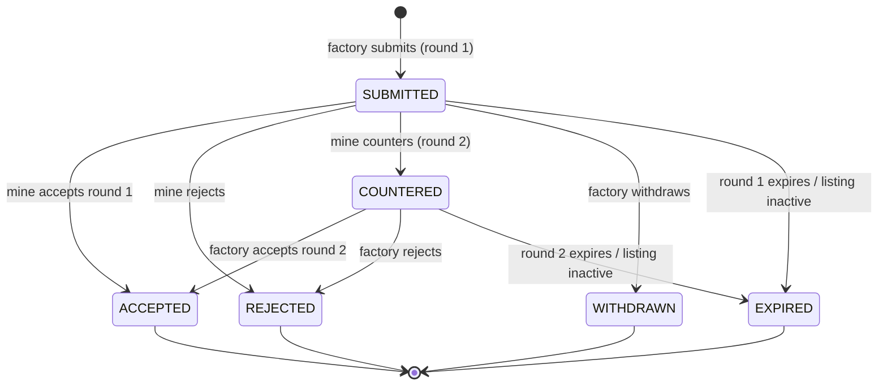
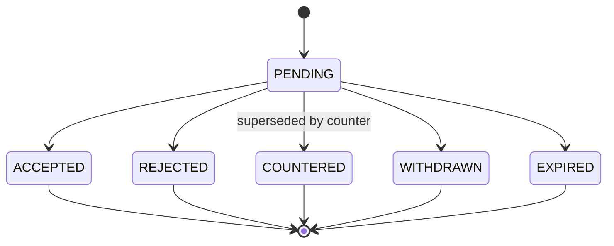
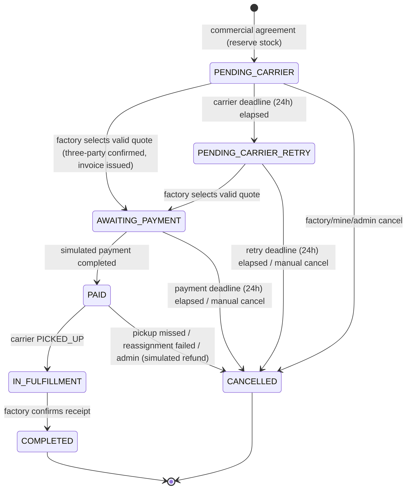
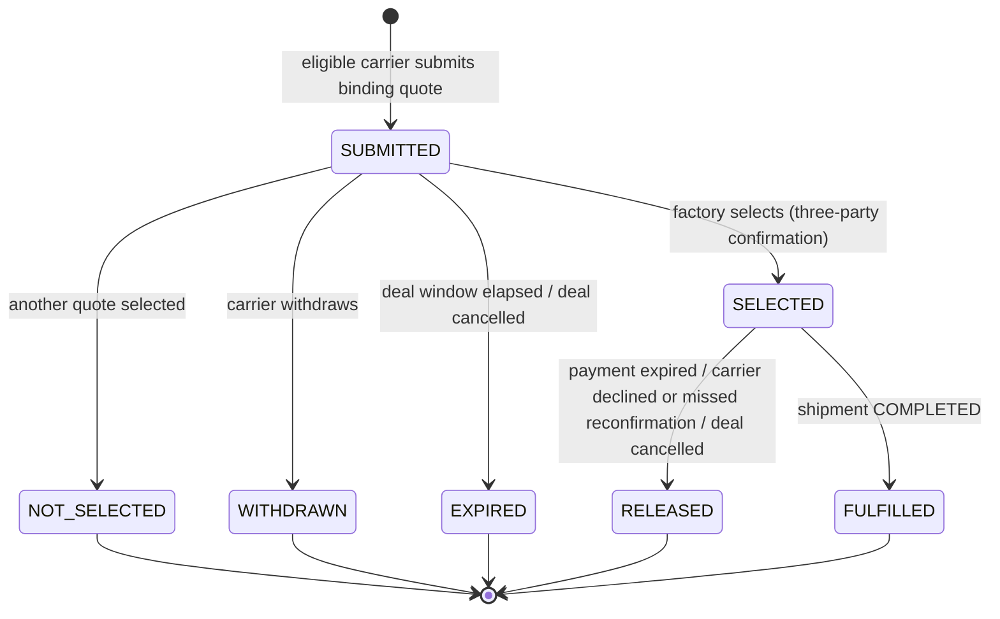
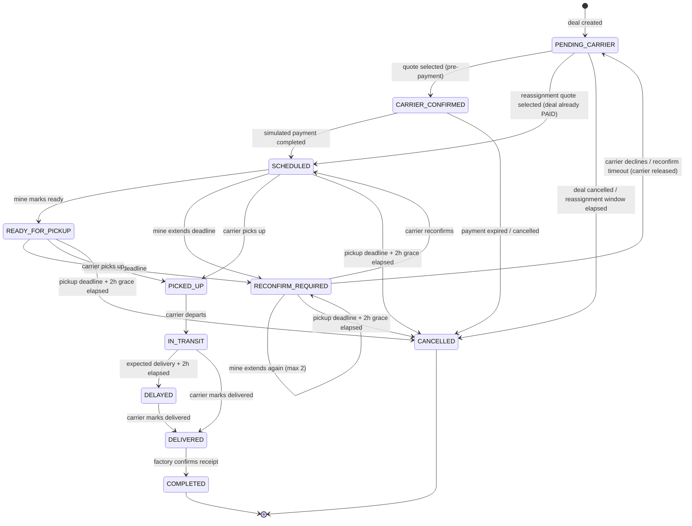
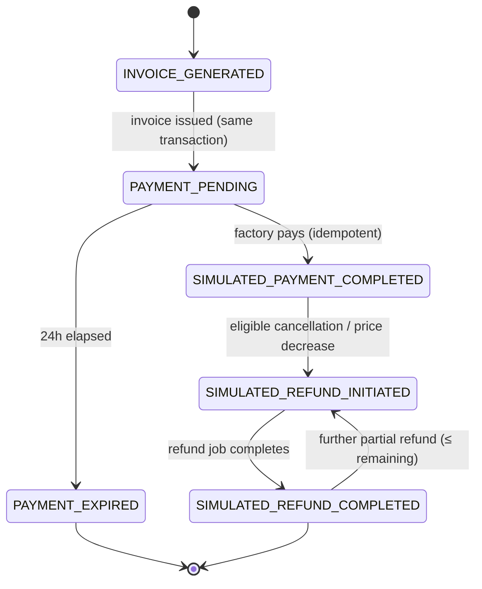
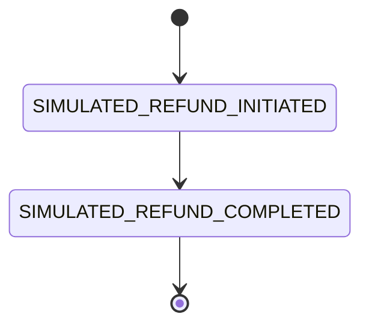

# آلات الحالة — مَكْنَز | MAKNAZ

[← فهرس الوثائق](../README.md) · [SRS](../02-requirements/MAKNAZ_SRS.md)

## 0. مبادئ التنفيذ

1. **كل انتقال عبر دالة خدمة واحدة** (مثل `DealService.select_quote`) لا عبر تعديل الحقل مباشرة.
2. **تحديث مشروط:** `UPDATE ... SET status = :to WHERE id = :id AND status = :from` (أو `SELECT ... FOR UPDATE` ثم تحقق). إذا لم يتأثر صف ← `409 STATE_CONFLICT`.
3. **الذرية:** الانتقال وآثاره الجانبية في قاعدة البيانات في معاملة واحدة؛ الإشعارات تُكتب في جدول `notifications` داخل المعاملة وتُرسل بعد الالتزام (outbox).
4. **التدقيق:** كل انتقال يكتب `audit_logs` (و`shipment_events` للشحنات).
5. **الحالات النهائية** لا تخرج منها: `REJECTED`, `WITHDRAWN`, `EXPIRED`, `ACCEPTED` (للعرض)، `COMPLETED`, `CANCELLED` (للصفقة والشحنة).
6. ترتيب القفل الثابت لتجنب الجمود: `deal → shipment → invoice → material_listing`.

## 1. عرض الشراء (`purchase_offers.status`)

| من | إلى | المحفز | الفاعل | الشروط | الآثار | الإشعار | الفشل |
|---|---|---|---|---|---|---|---|
| — | SUBMITTED | `POST /offers` | FACTORY | BR-020/021 | جولة 1 + مهلة `OFFER_ROUND` | المنجم | `422`, `409 OPEN_OFFER_EXISTS` |
| SUBMITTED | ACCEPTED | accept | MINE | جولة 1 `PENDING` وغير منتهية | حجز + صفقة + شحنة (§3) | الطرفان، الناقلون | `409 INSUFFICIENT_QUANTITY` ← تراجع، تبقى `SUBMITTED` |
| SUBMITTED | REJECTED | reject | MINE | — | جولة 1 `REJECTED` | المصنع | `409 INVALID_STATE` |
| SUBMITTED | COUNTERED | counter | MINE | لا عرض مقابل سابق، سعر مختلف، كمية ≤ | جولة 1 `COUNTERED`، جولة 2 + مهلة | المصنع | `422` |
| SUBMITTED | WITHDRAWN | withdraw | FACTORY | — | جولة 1 `WITHDRAWN` | المنجم | `409` |
| SUBMITTED/COUNTERED | EXPIRED | مهلة / إيقاف المادة | SYSTEM | الجولة `PENDING` | الجولة `EXPIRED` | الطرفان | `SKIPPED` إن تغيرت الحالة |
| COUNTERED | ACCEPTED | counter/accept | FACTORY | جولة 2 `PENDING` وغير منتهية | حجز + صفقة + شحنة | الطرفان، الناقلون | `409 INSUFFICIENT_QUANTITY` |
| COUNTERED | REJECTED | counter/reject | FACTORY | — | جولة 2 `REJECTED` | المنجم | `409` |

## 2. جولة التفاوض (`offer_negotiation_rounds.status`)

ثابت: جولة `PENDING` واحدة على الأكثر لكل عرض (فهرس فريد جزئي). الجولة لا تُعدل بعد إنشائها سوى حقول `status`, `responded_at`, `responded_by`.

**القبول المتزامن:** قبول المنجم للجولة 1 بالتوازي مع سحب المصنع ← كلاهما يحدّث بشرط `status = PENDING`؛ الأسبق ينجح والآخر `409`. قبول عرضين مختلفين على المادة نفسها بالتوازي ← الحجز الذري يحسم (BR-028).

## 3. الصفقة (`deals.status`)

| من | إلى | المحفز | الفاعل | الشروط | الآثار | الإشعار | الفشل |
|---|---|---|---|---|---|---|---|
| — | PENDING_CARRIER | قبول تجاري | MINE/FACTORY | حجز ناجح | لقطة، شحنة `PENDING_CARRIER`، مهلة 24h | الكل + الناقلون | تراجع كامل |
| PENDING_CARRIER(_RETRY) | AWAITING_PAYMENT | select quote | FACTORY | BR-039 | عرض `SELECTED`، الباقي `NOT_SELECTED`، شحنة `CARRIER_CONFIRMED`، فاتورة، مهلة دفع 24h، مهلة الناقل `SKIPPED` | الثلاثة | `409 QUOTE_NOT_AVAILABLE` / `STATE_CONFLICT` |
| PENDING_CARRIER | PENDING_CARRIER_RETRY | مهلة | SYSTEM | لا تأكيد ثلاثي | `retry_deadline_at`، تمديد صلاحية العروض، توسيع المطابقة | الثلاثة + ناقلون جدد | `SKIPPED` |
| PENDING_CARRIER_RETRY | CANCELLED | مهلة | SYSTEM | — | حجز `RELEASED`، عروض `EXPIRED`، شحنة `CANCELLED` | الطرفان | `SKIPPED` |
| AWAITING_PAYMENT | PAID | دفع | FACTORY | قبل المهلة، Idempotency | فاتورة مدفوعة، شحنة `SCHEDULED`، مهلة استلام | الثلاثة | `409 PAYMENT_EXPIRED` |
| AWAITING_PAYMENT | CANCELLED | مهلة | SYSTEM | لم يُدفع | فاتورة `PAYMENT_EXPIRED`، حجز `RELEASED`، عرض `RELEASED`، شحنة `CANCELLED` | الثلاثة | `SKIPPED` |
| PAID | IN_FULFILLMENT | pickup | CARRIER | الشحنة `PICKED_UP` | — | الطرفان | — |
| PAID | CANCELLED | `PICKUP_MISSED` / `NO_CARRIER_REASSIGNED` / `REASSIGNMENT_PRICE_DECLINED` / admin | SYSTEM/FACTORY/ADMIN | الشحنة قبل `PICKED_UP` | استرجاع كامل، حجز `RELEASED` | الثلاثة | `SKIPPED` |
| IN_FULFILLMENT | COMPLETED | confirm receipt | FACTORY | الشحنة `DELIVERED` | حجز `CONSUMED` | الثلاثة | `409` |

**ثوابت الصفقة:**
- `unit_price_halalas`, `quantity_tons`, `material_total_halalas` لا تتغير بعد الإنشاء.
- `status ∈ {PENDING_CARRIER, PENDING_CARRIER_RETRY, AWAITING_PAYMENT, PAID, IN_FULFILLMENT}` ⇒ يوجد حجز `ACTIVE` واحد.
- `status ∈ {AWAITING_PAYMENT, PAID, IN_FULFILLMENT, COMPLETED}` ⇒ يوجد عرض نقل `SELECTED` واحد وفاتورة واحدة.
- لا يمكن الوصول إلى `PAID` دون المرور بـ `AWAITING_PAYMENT` (لا دفع قبل التأكيد الثلاثي).

**الإلغاء بعد الدفع:** يُسمح فقط قبل `PICKED_UP`، ويولد دائمًا استرجاعًا كاملًا (ناقص أي استرداد جزئي سابق). بعد `PICKED_UP` لا مسار إلغاء في MVP.

## 4. تأكيد الناقل (`transport_quotes.status`)

| من | إلى | المحفز | الفاعل | الشروط | الآثار |
|---|---|---|---|---|---|
| — | SUBMITTED | submit | CARRIER | أهلية، لا عرض `SUBMITTED` آخر للناقل على الصفقة | لقطة تسعير، `expires_at` |
| SUBMITTED | SELECTED | select | FACTORY | `now < expires_at` | انظر §3 |
| SUBMITTED | EXPIRED | انتهاء نافذة الصفقة | SYSTEM | — | — |
| SUBMITTED | (يبقى) | بدء فترة إعادة المحاولة | SYSTEM | — | `expires_at = retry_deadline_at` (BR-038) |
| SELECTED | RELEASED | اعتذار / انقضاء إعادة التأكيد / إلغاء | CARRIER/SYSTEM | الشحنة قبل `PICKED_UP` | الشحنة `PENDING_CARRIER` (إعادة إسناد) أو `CANCELLED` |
| SELECTED | FULFILLED | إكمال الشحنة | SYSTEM | — | — |

**تعدد الناقلين:** يمكن لعدة ناقلين تقديم عروض متزامنة. الاختيار يقفل صف الصفقة؛ طلب اختيار ثانٍ متزامن يجد الصفقة `AWAITING_PAYMENT` ← `409 STATE_CONFLICT`. لا يفوز الأول تلقائيًا (OD-01).

## 5. الشحنة (`shipments.status`)

| من | إلى | الفاعل | الشروط | البيانات المطلوبة | الإشعار | آثار وتعويض |
|---|---|---|---|---|---|---|
| PENDING_CARRIER | CARRIER_CONFIRMED | FACTORY (select) | الصفقة قبل الدفع | `quote_id` | الثلاثة | `carrier_org_id`, `planned_pickup_at` |
| PENDING_CARRIER | SCHEDULED | FACTORY (select إعادة إسناد) | الصفقة `PAID`؛ موافقة الفرق إن كان أعلى | `quote_id`, `accept_price_difference?` | الثلاثة | استرجاع جزئي أو دفعة إضافية (BR-066) |
| CARRIER_CONFIRMED | SCHEDULED | SYSTEM (بعد الدفع) | دفعة مكتملة | — | الثلاثة | مهلة `PICKUP_DEADLINE` |
| SCHEDULED | READY_FOR_PICKUP | MINE | — | ملاحظة اختيارية | الناقل | — |
| SCHEDULED/READY/RECONFIRM | RECONFIRM_REQUIRED | MINE (تمديد) | BR-061/062 | `new_deadline`, `reason_code`, `reason_text` | الثلاثة | مهلة `CARRIER_RECONFIRM`، استبدال مهلة الاستلام |
| RECONFIRM_REQUIRED | SCHEDULED | CARRIER | قبل `reconfirm_deadline_at` | — | الطرفان | — |
| RECONFIRM_REQUIRED | PENDING_CARRIER | CARRIER / SYSTEM | اعتذار أو انقضاء | سبب الاعتذار | الثلاثة + الإدارة | العرض `RELEASED`، مهلة `REASSIGNMENT` 24h، الموعد يبقى |
| SCHEDULED/READY | PICKED_UP | CARRIER | `now ≤ deadline + 2h` | الوزن والمركبات (اختياري) | الطرفان | الصفقة `IN_FULFILLMENT`، مهلة `DELIVERY_ETA` |
| * (قبل PICKED_UP) | CANCELLED | SYSTEM | `now ≥ deadline + 2h` | — | الثلاثة + الإدارة | الصفقة `CANCELLED (PICKUP_MISSED)`، استرجاع كامل، حجز `RELEASED` |
| PICKED_UP | IN_TRANSIT | CARRIER | — | — | الطرفان | — |
| IN_TRANSIT | DELAYED | SYSTEM | `now ≥ expected + 2h` | — | الثلاثة + الإدارة | **لا إلغاء** |
| IN_TRANSIT/DELAYED | DELIVERED | CARRIER | — | ملاحظة | المصنع | تنبيه إداري بعد 72h إن لم يؤكد (BR-056) |
| DELIVERED | COMPLETED | FACTORY | — | ملاحظة اختلاف اختيارية | الثلاثة | الصفقة `COMPLETED`، حجز `CONSUMED`، عرض `FULFILLED` |

**ثوابت الشحنة:**
- `extension_count ≤ 2`.
- الحالات `PICKED_UP`, `IN_TRANSIT`, `DELAYED`, `DELIVERED` لا تملك أي انتقال إلى `CANCELLED` (حماية الشحنات المنقولة).
- `RECONFIRM_REQUIRED` يتطلب ناقلًا مسندًا.
- التمديد ممنوع من `PICKED_UP` فما بعد.

## 6. الدفع المحاكى (`invoices.payment_status` و`simulated_payments.status`)

ملاحظة: `INVOICE_GENERATED` و`PAYMENT_PENDING` يُكتبان في المعاملة نفسها؛ يُحفظ الأول كحدث تدقيق ويبقى الثاني حالة ظاهرة. بند تسوية إضافي (فرق سعر أعلى عند إعادة الإسناد) يُنشئ دفعة محاكاة مستقلة مرتبطة بـ `invoice_item` من نوع `ADJUSTMENT` دون إعادة حالة الفاتورة إلى `PAYMENT_PENDING` (REC).

| من | إلى | الفاعل | الشروط | منع التكرار |
|---|---|---|---|---|
| PAYMENT_PENDING | SIMULATED_PAYMENT_COMPLETED | FACTORY | الصفقة `AWAITING_PAYMENT`، قبل المهلة | `Idempotency-Key` + فهرس فريد جزئي `simulated_payments(invoice_id) WHERE status='COMPLETED' AND kind='PRIMARY'` |
| PAYMENT_PENDING | PAYMENT_EXPIRED | SYSTEM | `now ≥ payment_deadline_at` | تحديث مشروط |
| SIMULATED_PAYMENT_COMPLETED | SIMULATED_REFUND_INITIATED | SYSTEM | BR-046 | مفتاح فريد للاسترجاع |

**سباق الدفع مقابل المهلة:** الدفع يقفل الفاتورة ويتحقق `now < payment_deadline_at`؛ المهمة تقفل الصفقة وتتحقق `status = AWAITING_PAYMENT`. ترتيب القفل الموحد (صفقة ← فاتورة) يمنع الجمود؛ الأسبق يفوز.

## 7. الاسترجاع المحاكى (`simulated_refunds.status`)

القيود: `amount_halalas > 0`؛ `SUM(refunds) ≤ SUM(completed payments)` لكل فاتورة (يُتحقق تحت قفل)؛ مفتاح فريد `(invoice_id, source_type, source_id)` حيث المصدر هو الإلغاء أو إعادة الإسناد.

## 8. معالجات خاصة

| الحالة | المعالجة |
|---|---|
| قبول متزامن لعروض على المادة نفسها | حجز ذري مشروط؛ الفاشل `409 INSUFFICIENT_QUANTITY` دون أثر |
| انقضاء مهلة الناقل | `PENDING_CARRIER_RETRY` مرة واحدة، ثم إلغاء وتحرير الحجز |
| تمديد موعد الشحن | الموعد يتغير فورًا (سلطة المنجم)، إعادة تأكيد مطلوبة من الناقل |
| عدم توفر الناقل بعد التمديد | تحرير الناقل وإعادة إسناد خلال 24h؛ الفشل ← إلغاء واسترجاع |
| انقضاء مهلة الدفع | إلغاء وتحرير الحجز والناقل |
| إلغاء بعد الدفع | الإدارة أو النظام فقط، قبل `PICKED_UP`، مع استرجاع كامل |
| شحنة في الطريق | لا إلغاء ولا تمديد؛ التأخر ← `DELAYED` وتنبيه |
| مهام مجدولة فاشلة أو مكررة | `FOR UPDATE SKIP LOCKED`، تحديث مشروط بالحالة، `SKIPPED` عند عدم المطابقة، إعادة حتى 5 مرات ثم `FAILED` وتنبيه |
| مهلة فائتة أثناء توقف الخادم | تُنفذ عند أول تشغيل بالترتيب الزمني (catch-up) |
| تعليق جهة طرف | لا تغيير تلقائي؛ قائمة إدارية «تحتاج معالجة» |
