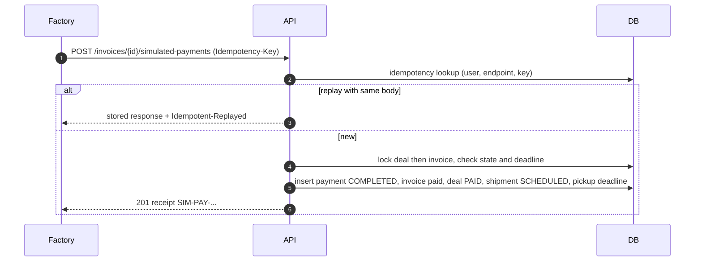

# محاكاة الدفع والاسترجاع

[← فهرس الوثائق](../README.md)

> ⚠️ **في النسخة الأولى لا تحويلات مالية حقيقية، ولا بطاقات، ولا بوابة دفع، ولا ضمان (escrow)، ولا استرداد بنكي.** كل عملية تحمل الوسم `DEMO / SIMULATION`. القواعد المرجعية: BR-041–048، وآلة الحالة في [TRANSACTION_STATE_MACHINE.md §6–7](../03-architecture/TRANSACTION_STATE_MACHINE.md#6-الدفع-المحاكى-invoicespayment_status-وsimulated_paymentsstatus).

## 1. متى يُسمح بالدفع

| الشرط | القيمة |
|---|---|
| حالة الصفقة | `AWAITING_PAYMENT` (أي بعد التأكيد الثلاثي) |
| الفاعل | عضو في جهة المصنع المشترية، والجهة `ACTIVE` |
| الوقت | قبل `payment_deadline_at` = إصدار الفاتورة + 24 ساعة |
| الترويسة | `Idempotency-Key` إلزامي |

**لا دفع قبل التأكيد الثلاثي** — `409 THREE_PARTY_CONFIRMATION_REQUIRED`.

## 2. التدفق

## 3. الحالات

| الحالة | المعنى |
|---|---|
| `INVOICE_GENERATED` | أُنشئت الفاتورة (حدث تدقيق) |
| `PAYMENT_PENDING` | بانتظار الدفع المحاكى |
| `SIMULATED_PAYMENT_COMPLETED` | دُفعت محاكاة |
| `PAYMENT_EXPIRED` | انقضت المهلة؛ الصفقة أُلغيت |
| `SIMULATED_REFUND_INITIATED` | بدأ استرجاع محاكٍ |
| `SIMULATED_REFUND_COMPLETED` | اكتمل الاسترجاع المحاكى |

## 4. منع التكرار

1. `Idempotency-Key` مع تجزئة الطلب: نفس المفتاح والجسم ← نفس الاستجابة؛ نفس المفتاح بجسم مختلف ← `409 IDEMPOTENCY_KEY_REUSED`.
2. فهرس فريد جزئي: دفعة `PRIMARY` مكتملة واحدة لكل فاتورة.
3. ترتيب أقفال موحد (صفقة ← فاتورة) يحسم السباق مع مهمة انتهاء المهلة.

## 5. الاسترجاع المحاكى

| الحالة | المبلغ |
|---|---|
| إلغاء بعد الدفع وقبل `PICKED_UP` (أي سبب) | كامل المدفوع ناقص المسترد سابقًا |
| إعادة إسناد بسعر نقل أقل | الفرق |
| بعد `PICKED_UP` | لا استرجاع عبر النظام في MVP |

القيود: المبلغ > 0؛ مجموع الاستردادات ≤ المدفوع (تحت قفل)؛ مفتاح فريد `(invoice_id, source_type, source_id)` يمنع التكرار.

## 6. الدفعة الإضافية (إعادة الإسناد بسعر أعلى)

تتطلب موافقة صريحة من المصنع على فرق **السعر** (لا على التمديد)، وتُنشئ بند `ADJUSTMENT` ودفعة محاكاة من نوع `ADJUSTMENT`. (Should — OD-07)

## 7. الواجهة

شارة `SimulationBadge` في الفاتورة والإيصال وPDF؛ نافذة تأكيد: «عملية محاكاة — لن يتم تحويل أي أموال»؛ عداد المهلة بتوقيت الرياض.

## 8. الاختبارات

TS-090–104، وAC-07، AC-08، AC-16.
