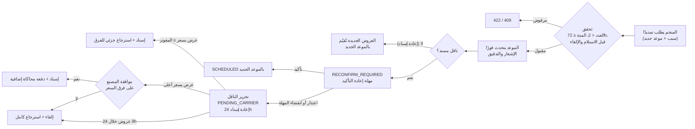

# تمديد موعد الشحن وإعادة تأكيد الناقل

[← فهرس الوثائق](../README.md)

> القرار المعتمد: **المنجم وحده يملك تمديد موعد الشحن**، دون موافقة المصنع، ودون حق اعتراض للناقل؛ مع إعادة تأكيد جاهزية الناقل التشغيلية للموعد الجديد. القواعد: BR-060–067؛ UC-015، UC-016.

## 1. القيم المعتمدة

| القاعدة | القيمة |
|---|---|
| الحد الأقصى للتمديدات لكل شحنة | 2 |
| أقصى مدة لكل تمديد | 72 ساعة بعد الموعد الحالي |
| السبب | إلزامي (رمز + وصف 10–500 حرف) |
| الإشعارات | إلزامية للمصنع والناقل |
| سجل التدقيق | إلزامي |

## 2. متى يُسمح

الحالات: `SCHEDULED`، `READY_FOR_PICKUP`، `RECONFIRM_REQUIRED`، و`PENDING_CARRIER` أثناء إعادة الإسناد — وقبل `pickup_deadline_at + 2h`. ممنوع بعد `PICKED_UP`.

## 3. الفصل بين السلطتين

| السلطة | صاحبها | الأثر |
|---|---|---|
| تغيير الموعد | المنجم | فوري ونهائي؛ لا يُعاد الموعد القديم أبدًا |
| الالتزام التشغيلي بالموعد الجديد | الناقل | يؤكد أو يعتذر؛ لا يملك تغيير الموعد |

## 4. التدفق

## 5. مهلة إعادة التأكيد (REC — OD-06)

`reconfirm_deadline_at` = الأقرب بين `now + 12h` و`new_pickup_deadline − 2h`، وبحد أدنى ساعة.

## 6. أمثلة

| السيناريو | النتيجة |
|---|---|
| تمديد أول 48 ساعة، والناقل يؤكد | `SCHEDULED`، التمديدات 1/2 |
| تمديد ثانٍ 72 ساعة، والناقل يعتذر | الموعد الجديد يبقى؛ إعادة إسناد 24 ساعة |
| تمديد ثالث | `422 EXTENSION_LIMIT_REACHED` |
| تمديد 72 ساعة ودقيقة | `422 EXTENSION_TOO_LONG` |
| المصنع يحاول التمديد | `403 FORBIDDEN_ROLE` |
| تمديد بعد الاستلام | `409 SHIPMENT_ALREADY_PICKED_UP` |

## 7. الاختبارات

TS-110–122، AC-09–AC-11.
