# خطة تنفيذ النسخة الأولى (8 أيام) — مَكْنَز | MAKNAZ

[← فهرس الوثائق](../README.md) · [SRS](../02-requirements/MAKNAZ_SRS.md)

> المسؤوليات التفصيلية لكل عضو، دون جدول زمني، في [MAKNAZ_TEAM_RESPONSIBILITIES.md](../07-team/TEAM_RESPONSIBILITIES.md). هذه الوثيقة تحدد **التسلسل والاعتماديات ونقاط القبول** خلال 8 أيام عمل بالأدوار: **SE** هندسة البرمجيات · **UX** التصميم · **DA** البيانات · **BD** تطوير الأعمال · **QA** ضمان الجودة.

## 1. تقييم واقعي

| العامل | الأثر |
|---|---|
| مهندس برمجيات واحد (SE) للواجهة والخلفية | **الخطر الأكبر**؛ المسار الحرج كله عليه |
| المنطق المعقد (حجز ذري، تأكيد ثلاثي، مهل، تمديد وإعادة إسناد، استرجاع) | يستهلك أكثر من نصف وقت التطوير |
| 8 أيام | لا مجال لإعادة العمل؛ القرارات المفتوحة الحمراء تُحسم في اليوم الأول |

**قرارات تقليل المخاطر (REC):**
1. شاشات الإدارة تُبنى على **لوحة Django Admin** مخصصة بدل واجهة مستقلة.
2. الإشعارات داخل المنصة فقط؛ البريد Should.
3. الخرائط للعرض واختيار النقطة فقط.
4. النقل البري المحلي فقط مفعّل؛ الأنماط الأخرى في نموذج البيانات.
5. UX يسلم **مكتبة مكونات وقوالب صفحات** قابلة للنسخ (Tailwind) لا تصاميم فقط، لتقليل وقت الواجهة.
6. DA يجهز بيانات تجريبية جاهزة للتحميل كـ fixtures.
7. إذا تأخر المسار الحرج في نقطة التحقق لليوم الرابع ← تُنقل «إعادة الإسناد بسعر أعلى» و«الملف العام للناقل» و«تأكيد المناولة» إلى Post-MVP.

## 2. تصنيف النطاق (MoSCoW)

| الفئة | العناصر |
|---|---|
| **Must Have** | التسجيل والجهات والاعتماد (Django Admin) · المناجم ومواقع المصانع · المواد والمواصفات بوسومها والوثائق · البحث والتصفية · عروض الشراء والعرض المقابل · الحجز الذري والصفقات · مواقع الناقل وخدماته وقواعد التسعير (4 نماذج) · المطابقة بالأهلية والنطاقات · عروض النقل · التأكيد الثلاثي · الفاتورة والدفع المحاكى بـ Idempotency · دورة الشحنة · التمديد الحصري للمنجم وإعادة التأكيد · إعادة الإسناد (بسعر مساوٍ أو أقل) · المهل والإلغاء التلقائي · الاسترجاع المحاكى · سجل التدقيق · الإشعارات داخل المنصة · لوحات الأدوار الأساسية · بيانات تجريبية |
| **Should Have** | إعادة الإسناد بسعر أعلى بموافقة المصنع · بريد الإشعارات الحرجة · PDF الفاتورة · معاينة التسعير · عرض الخريطة في البحث · دعوة الأعضاء · التراخيص المصرّحة ومراجعتها · تأكيد المناولة · شاشة «تحتاج معالجة» |
| **Could Have** | مرشح «يحتوي تقريرًا» · مؤشرات اللوحات · الملف العام للناقل · إعادة تعيين كلمة المرور |
| **Post-MVP** | واجهة تعديل السياسات · بوابة دفع حقيقية وفواتير ضريبية · خدمة توجيه مسارات · السكك والبحري والدولي فعليًا · التسليم الجزئي · النزاعات والجزاءات · التقييمات · تطبيقات الجوال · التكاملات مع المختبرات · أي ذكاء اصطناعي |

## 3. المسار الحرج

```mermaid
flowchart RL
    A["D1: Schema + Auth + Orgs"] --> B["D2: Mines + Listings + Search"]
    B --> C["D3: Offers + Atomic reservation + Deals"]
    C --> D["D4: Carrier services + Pricing engine + Matching + Quotes"]
    D --> E["D5: Three-party confirm + Invoice + Payment + Scheduler"]
    E --> F["D6: Shipments + Extension + Reconfirm + Auto-cancel + Refunds"]
    F --> G["D7: Dashboards + Admin + E2E + Fixes"]
    G --> H["D8: Regression + Demo data + Rehearsal"]
```

## 4. الخطة اليومية

### اليوم 1 — الأساس
| الدور | المخرجات |
|---|---|
| الفريق | حسم OD-01، OD-02، OD-05، OD-07، OD-10، OD-18 (اجتماع قرار قصير) |
| SE | هيكل المستودع ووحدات الـmonolith؛ Docker Compose؛ نماذج وترحيلات الجداول الأساسية؛ المصادقة والجهات والعضوية؛ صلاحيات `required_org_types`؛ بذرة السياسة v1 والفئات |
| UX | المستخدمون والتدفقات الأربعة؛ Wireframes: التسجيل، البحث، تفاصيل المادة، العرض، مركز الصفقة |
| DA | قاموس البيانات؛ قالب CSV للفئات والمناجم والمواد والمواصفات والناقلين |
| BD | دليل المقابلات وقائمة الجهات المستهدفة للتحقق |
| QA | خطة الاختبار؛ مصفوفة التتبع من SRS؛ مولد اختبارات RBAC |
| **نقطة القبول** | ترحيلات تعمل؛ تسجيل ودخول وجهة `PENDING_REVIEW` واعتماد من Django Admin |

### اليوم 2 — المواد والبحث
| الدور | المخرجات |
|---|---|
| SE | المناجم ومواقع المصانع؛ المواد والمواصفات (قيود الوسوم)؛ رفع الوثائق والروابط الموقعة؛ البحث والتصفية؛ صفحات الواجهة للبحث والتفاصيل والنماذج |
| UX | التصاميم عالية الدقة لنفس الشاشات + مكتبة المكونات (Badges، Tags، MoneyBreakdown، DeadlineTimer) |
| DA | بيانات تجريبية v1 (مواد ومواصفات بوسوم متنوعة) |
| QA | حالات TS-010–019 وTS-020–035 |
| **نقطة القبول** | منجم ينشر مادة بوسوم؛ مصنع يبحث ويرى المسافة الموسومة |

### اليوم 3 — التفاوض والحجز
| الدور | المخرجات |
|---|---|
| SE | العروض والجولات؛ قبول/رفض/عرض مقابل؛ **الحجز الذري**؛ إنشاء الصفقة والشحنة والمهلة؛ Idempotency middleware؛ شاشات العروض والتفاوض |
| UX | شاشات الناقل (الخدمات، التسعير، الفرص) ومقارنة العروض |
| DA | بيانات الناقلين ومواقعهم التشغيلية بنطاقات مسافة متنوعة؛ أمثلة تسعير |
| QA | TS-040–056؛ **اختبار التزامن TS-051** |
| **نقطة القبول** | TS-051 ناجح؛ لا بيع زائد |

### اليوم 4 — الناقلون والتسعير والمطابقة
| الدور | المخرجات |
|---|---|
| SE | مواقع ومناطق وخدمات الناقل؛ إصدارات التسعير وتفعيلها؛ **الحاسبة النقية** (4 نماذج، رسوم، حد أدنى، تقريب)؛ المطابقة؛ تقديم عروض النقل بلقطة |
| UX | الفاتورة والدفع المحاكى، الشحنة، التمديد، إعادة التأكيد، اللوحات |
| DA | نموذج تقديري لتكلفة النقل للتحقق من مخرجات الحاسبة (حالات معروفة النتيجة) |
| QA | TS-060–079 مع قيم DA المرجعية |
| **نقطة القبول** | حاسبة مطابقة لقيم DA؛ ناقل غير متوافق لا يظهر. **قرار تقليص النطاق إن تأخر المسار** |

### اليوم 5 — التأكيد الثلاثي والدفع والمجدول
| الدور | المخرجات |
|---|---|
| SE | اختيار العرض والتأكيد الثلاثي الذري؛ الفاتورة وبنودها؛ الدفع المحاكى؛ جدول المهل والمعالج كل دقيقة؛ مهل الناقل وإعادة المحاولة والدفع |
| UX | الحالات الفارغة والخطأ والتحميل لكل الشاشات؛ النماذج التفاعلية |
| DA | مؤشرات اللوحات وتعريفاتها |
| BD | مدخلات عرض القيمة لكل طرف لصياغة نصوص الواجهة |
| QA | TS-080–099، TS-130–132 |
| **نقطة القبول** | لا دفع قبل التأكيد الثلاثي؛ TS-093 ناجح |

### اليوم 6 — الشحن والتمديد والإلغاء
| الدور | المخرجات |
|---|---|
| SE | حالات الشحنة؛ التمديد الحصري للمنجم؛ إعادة التأكيد وإعادة الإسناد؛ مهلة الاستلام + السماح والإلغاء التلقائي؛ الاسترجاع المحاكى؛ `DELAYED`؛ الشاشات المقابلة |
| UX | مراجعة تنفيذ الواجهة (RTL، التباين، التجاوب) وقائمة ملاحظات |
| QA | TS-100–122، TS-133–141 |
| **نقطة القبول** | TS-110–117 و TS-134–135 ناجحة |

### اليوم 7 — اللوحات والإدارة والتكامل
| الدور | المخرجات |
|---|---|
| SE | لوحات الأدوار؛ الإشعارات؛ تخصيص Django Admin (الاعتماد، الإشراف، التدقيق، الإلغاء الإداري)؛ تحميل البيانات التجريبية؛ إصلاح العيوب |
| UX | تدقيق نهائي وتسليم الأصول |
| DA | البيانات النهائية ورسوم العرض |
| BD | نص العرض التجريبي وسيناريو القصة |
| QA | E2E TS-150–155؛ التوافق |
| **نقطة القبول** | TS-150 ناجح كاملًا |

### اليوم 8 — التثبيت والعرض
| الدور | المخرجات |
|---|---|
| SE | إصلاح S1/S2؛ النسخ الاحتياطي؛ النشر على بيئة العرض |
| QA | الانحدار الكامل؛ تقرير الجاهزية |
| الفريق | بروفة العرض بثلاث حسابات تجريبية |
| **نقطة القبول** | معايير الخروج في [TEST_STRATEGY §8](../06-quality/TEST_STRATEGY.md#8-معايير-الجاهزية-للعرض-exit-criteria) |

## 5. المخاطر

| الخطر | الاحتمال | الأثر | التخفيف |
|---|---|---|---|
| عبء SE الوحيد | عالٍ | عالٍ | Django Admin؛ مكونات UX جاهزة؛ نقطة تقليص النطاق في اليوم 4؛ QA يكتب اختبارات API كمواصفات تنفيذية |
| أخطاء التزامن في الحجز والدفع | متوسط | عالٍ | تحديثات مشروطة + فهارس فريدة جزئية + اختبارات تزامن مبكرة |
| تعقيد إعادة الإسناد | عالٍ | متوسط | تنفيذ المسار المساوي/الأقل أولًا؛ الأعلى Should |
| مهل زمنية يصعب اختبارها | متوسط | عالٍ | حقن الساعة؛ أمر إداري لتشغيل المعالج يدويًا في العرض |
| عرض العربية والأرقام | متوسط | متوسط | IBM Plex Sans Arabic؛ `<bdi>`؛ اختبار بصري |
| قرارات مفتوحة غير محسومة | متوسط | عالٍ | التوصيات تُنفذ افتراضيًا ما لم يُعتمد غيرها في اليوم 1 |
| شروط بلاطات الخرائط | منخفض | منخفض | مزود مرخص أو خريطة ثابتة في العرض |

## 6. العرض التجريبي

لإظهار المهل دون انتظار 24 ساعة: إصدار سياسة خاص ببيئة العرض (`demo` بقيم بالدقائق) **موسوم ومعزول عن الإعدادات الافتراضية**، أو أمر إداري `advance_clock` في بيئة العرض فقط. لا يُستخدم في أي بيئة أخرى.
